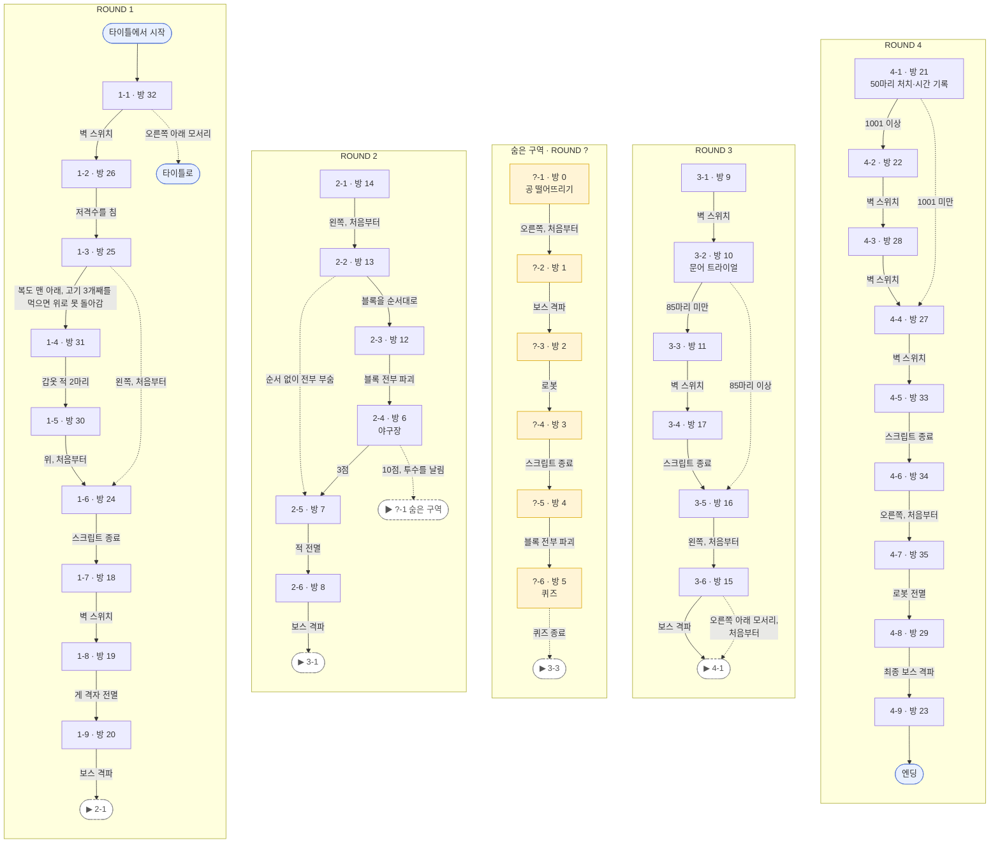

# 환세쾌진극 웹 포팅 노트

여기 적은 내용은 EXE 코드나 파일 내용으로 확인한 사실이다. 확인하지 못한 것은 "미확인"에 따로 모은다.

원본에 없는 확장(대사·크레딧 정렬, 설정 화면 추가 줄, 터치, 백그라운드 처리, 페이지 요소, 팬 메이드 캐릭터)은 `EXTENSION.md`에 둔다.

## 방향

- 원본 실행 파일을 에뮬레이션하지 않고 엔진을 새로 구현한다(TypeScript + Canvas, 번들러·외부 런타임 라이브러리 없음).
- 실행에 EXE가 필요 없다. 게임 로직이 쓰는 EXE 안의 표(삼각함수, 프레임 표, 방 표, 키 대응, 사각형 표, 데모 입력 등 78개, 52KB)는 로컬 역분석 도구로 일본판 EXE에서 추출해 `src/data/gameTables.ts`에 숫자로 넣어 두었다(두 판의 표 내용은 대사 포인터 표를 빼면 같다). 대사는 `assets/text/texts.tsv`에서 읽는다.
- 런타임은 원본 파일 형식을 읽지 않는다. 원본 폴더(`original/kr`·`original/jp`, 사운드폰트 `original/SC-55.sf3`)는 `original/extract/`의 변환 도구만 읽고, 결과는 `assets/`(`gfx/` 인덱스 PNG, `maps/` 방·배경 JSON, `audio/` WAV·OGG)에 둔다. 엔진과 개발 서버는 `assets/`만 쓴다. `assets/`는 변환 결과 전체를 커밋한다. `original/`(원본 파일과 그 아래 변환 도구 `extract/`, 분석 자료 `re/`)만 git에서 제외한다.
- 원본 로직은 함수 단위로 옮긴다. 객체 시스템(600개 풀, 층 10개 연결 목록, 해제 후에도 이전·다음 링크 유지), 40ms 프레임, 16.16 고정소수점, 버퍼 배치(MDT·ATR 활성/임시 연속 메모리)를 원본과 같게 둔다.
- 빌드와 실행: `tsc`가 `src/`를 `dist/`의 ES 모듈로 내보낸다(상대 import는 `.ts`로 쓰고 `rewriteRelativeImportExtensions`가 `.js`로 바꾼다). `npm run dev`는 `tools/serve.ts`(Node 내장 `http`, 외부 패키지 없음)가 `tsc --watch`와 함께 `index.html`·`dist/`·`assets/`만 서빙한다(기본 포트 7674, SMSH를 전화 키패드로 치환한 값. 인자로 변경. 접속은 `http://localhost:7674/`, PC에서 터치 화면은 `?touch=1`). 대사 표 `assets/text/texts.tsv`는 직접 쓰는 파일이라 커밋한다.
- 배포: `npm run build`가 `tsc`로 `dist/`를 만든 뒤 `tools/pack.ts`가 `index.html`·`dist/`·`assets/`를 `site/`로 모은다(7.8MB). 파일 주소는 모두 상대 경로라 `https://사용자.github.io/저장소/` 같은 하위 경로 호스팅에서도 동작한다(`/kaisin/` 하위 경로로 확인). `.github/workflows/pages.yml`은 `main`에 푸시하면 빌드해서 GitHub Pages로 올린다(저장소 설정에서 Pages 소스를 GitHub Actions로 지정해야 한다). `original/` 없이 빌드된다.
- 저장소 폴더: `src/`(엔진 소스), `assets/`(변환된 게임 데이터, 런타임이 읽는 유일한 데이터), `tools/`(`serve.ts` 개발 서버, `pack.ts` 배포 묶기), `work/`(팬 메이드 그림 작업 파일, 배포 제외, `EXTENSION.md` 참고), `.github/workflows/`(Pages 배포). 루트에는 `index.html`·`robots.txt`·`sitemap.xml`·`package.json`·`tsconfig.json`이 있다. `original/`은 git 제외 로컬 폴더이고 구성은 `original/README.md`에 있다.
- 빌드 산출물 폴더(둘 다 git 제외, 지워도 다시 생김): `dist/`는 `tsc`가 `src/`를 컴파일한 JS이며 개발 서버가 내주는 폴더다. `site/`는 `npm run build`가 배포할 파일(`index.html`·`dist/`·`assets/` 등)만 모은 폴더로 개발 중에는 쓰지 않는다. 실제 배포는 GitHub Actions가 서버에서 같은 빌드를 새로 해 그 `site/`를 올린다(로컬 `site/`가 올라가는 것이 아니다).
- 수정 반영: `npm run dev`를 켜 두면 `src/` 저장 시 `tsc --watch`가 다시 컴파일하고, `assets/`(`texts.tsv` 포함)는 컴파일 없이 새로고침만 하면 반영된다. 푸시하면 Actions가 빌드·배포하므로 로컬 빌드는 필요 없다. `tsc`가 에러를 내면 빌드가 실패해 사이트는 이전 버전으로 남으므로 푸시 전에 `npm run typecheck`를 돌린다. 커밋만으로는 배포되지 않고 푸시해야 배포된다.
- 개발 서버 URL 옵션: `?mode=trial`(장면 4로 시작), `?scene=ending|epilogue|clear|gameover|tomb|status`(해당 장면에서 시작), `?room=N`(시작 방). 개발 모드에서는 `window.kaisin.run(프레임수, 입력비트)`로 프레임을 직접 진행할 수 있다(숨김 탭에서는 requestAnimationFrame이 멈추므로).

### 작업 순서

게임 진행 기준으로, 라운드 하나를 처음부터 끝까지 통과할 수 있게 만든 뒤 다음으로 간다. 방 순서는 방 조건표 5·6번째 값(ROUND 표시)에서 얻었다.

| 단계 | 내용 | 남은 것 | 상태 |
|---|---|---|---|
| 0 | 객체 시스템, 플레이어, 방 이동, 기본 적, HUD, 효과음, 기타 TK 객체 | | 완료 |
| 1 | 라운드 1: 방 32, 26, 25, 31, 30, 24, 18, 19, 20 | 실플레이 통과 확인 | 구현 완료 |
| 2 | 게임 흐름 장면 | 게임 오버, 컨티뉴, 타이틀, 스테이터스 편집 | 구현 완료 |
| 3 | 라운드 2: 방 14, 13, 12, 6, 7, 8 | 실플레이 통과 확인 | 구현 완료 |
| 4 | 라운드 3: 방 9, 10, 11, 17, 16, 15 | 실플레이 통과 확인 | 구현 완료 |
| 5 | 라운드 4: 방 21, 22, 28, 27, 33, 34, 35, 29, 23 | 실플레이 통과 확인, 방 23 이후 장면 | 구현 완료(보스·방 전용) |
| 6 | 엔딩, 스태프롤, 패스워드, 상태 편집, 방 0~5(ROUND 표시 30번) | 실플레이 확인 | 구현 완료 | |
| 7 | BGM(MIDI), jp·kr 차이 마무리 | 음색·반복 귀로 확인 | BGM 구현 |

## CNS (그래픽)
- 변환 도구: `node original/extract/gfx.ts <원본 kr 폴더> <원본 jp 폴더> <출력 폴더>`가 CNS를 인덱스 컬러 PNG(8비트, PLTE에 원본 팔레트, 변환 전후 픽셀·팔레트가 일치함을 50개 모두 확인)로 저장한다. 언어별 6개는 `kr/`, `jp/` 하위에, 나머지는 한 벌만 둔다. 엔진은 `assets/gfx/`의 PNG를 `src/data/image.ts`로 읽는다(팔레트 번호가 게임 로직의 일부라 RGBA로 합치지 않고 인덱스 그대로 쓴다). CNS 디코더는 `original/extract/cns.ts`에만 있다.

- 압축: `0x422140`의 LZ. 명령 바이트 `c`:
  - `0` 끝
  - `1nnn llll` 리터럴 `nnn`바이트 후, 거리 1바이트로 `llll+2` 복사
  - `0x0L` 거리 1바이트, 길이 `L+2` / `0x1L` 거리 2바이트, 길이 `L+2`
  - `0x2L` 길이 `L<<8|b`, 거리 1바이트 / `0x3L` 길이 `L<<8|b`, 거리 2바이트
  - `0x40~0x5F` 리터럴 `c&0x1F`바이트 / `0x60~0x7F` 리터럴 `(c&0x1F)<<8|b`바이트
- 해제 후: `u16 0`, `u16 폭`, `u16 높이`, `u16 색수-1`, 팔레트 `색수×4`, 픽셀.
- 팔레트 항목은 B, G, R, 0 순서(`0x402f50`이 R·G·B로 뒤집어 `PALETTEENTRY`에 복사).
- 16색 이하면 4bpp(상위 니블이 왼쪽 픽셀), 그보다 많으면 8bpp. 행은 패딩 없이 아래에서 위 순서(`0x403140`).
- 44개 모두 16색 4bpp. 사용자 도구 `compile-gfx`와 `src/cns.ts`의 결과가 jp·kr 88개 파일에서 픽셀 단위로 일치한다.

### 시트 로드

로더는 4종이고 모두 `(표면 번호, 파일명, 팔레트 시작, 컬러키, …)` 순서다.

- 팔레트 시작: 시트의 색을 256색 팔레트의 이 위치부터 올리고(`0x402f50`), 픽셀 값에 이 값을 더해 표면에 쓴다(`0x403140`).
- 컬러키: DirectDraw `SetColorKey(DDCKEY_SRCBLT)`에 넘기는 전역 색 번호(`0x402f20`). 이 색이 투명이다. 팔레트 시작과 같으면 시트의 0번 색이 투명이고, 맵 타일처럼 범위 밖(5)이면 투명색이 없다.
- `0x4017d0(표면, 파일, 팔레트, 키, 셀폭, 셀높이)`: 균일 격자. 프레임 `n`은 `(n % (시트폭/셀폭)) * 셀폭, (n / (시트폭/셀폭)) * 셀높이`(`0x4022e0`, `0x4034f0`).
- `0x4018d0(표면, 파일, 팔레트, 키, 사각형표)`: 프레임마다 `RECT {i32 left, top, right, bottom}`(`0x402320`, `0x403840`).
- `0x401850`, `0x401950`: 각각 `0x4017d0`, `0x4018d0`과 같고, 표면을 시스템 메모리(`0x800`)로 만든다.

| 표면 | 파일 | 팔레트 | 키 | 셀/표 | 로드 위치 |
|---|---|---|---|---|---|
| 2 | `TIT_BG` | 0x10 | 5 | 32×32 | 타이틀(`0x4211bb`) |
| 2 | 방별 `MAP_DT_*` | 0x10 | 5 | 32×32 | 방 로드(`0x422650`) |
| 3 | `MAP_DT_2` | 0x20 | 5 | 32×32 | 공통(`0x4224f0`) |
| 4 | `MAP_DT_3` | 0x90 | 5 | 32×32 | 공통 |
| 5 | `SMASH` | 0x30 | 0x30 | 표 `0x43a650` | 공통 |
| 6 | `ZAKO_1` | 0x60 | 0x60 | 32×32 | 공통 |
| 7 | `ZAKO_2` | 0x70 | 0x70 | 32×32 | 공통 |
| 9 | `ZAKO_4` | 0xA0 | 0xA0 | 표 `0x43ac10` | 공통 |
| 0xA | `STATE_DT` | 0x40 | 0x40 | 128×64 | 공통 |
| 0xB | `SUUJI_DT` | 0x50 | 0x50 | 표 `0x439e40` | 공통 |
| 0xC | `IROIRO_0` | 0xB0 | 0xB0 | 표 `0x439550` | 공통 |
| 0xD | `ANI_SP` | 0xC0 | 0xC0 | 32×32 | 공통 |
| 0xF | `CIRCLE_S` | 0xB0 | 0xB0 | 32×32, 시스템 메모리 | 공통 |
| 0x10 | `UNEUNE` | 0x80 | 0x89 | 표 `0x43acb0`, 시스템 메모리 | 공통 |
| 0x11 | `UNEUNE` | 0x80 | 0x80 | 표 `0x43acb0`, 시스템 메모리 | 공통 |
| 0xE | 방별 스프라이트(아래) | 0xD0 | 0xD0 | | 방 로드 |
| 0xE | `TITLE_P` | 0xD0 | 0xD0 | 표 `0x43bdb0` | 타이틀 |
| 2 / 0xE | 엔딩·스태프(아래) | | | | 엔딩 |

- 방을 로드할 때(`0x422650`) 표면 2와 3을 해제(`0x4027b0`)하고 표면 2만 다시 로드한다. 공통 로더 `0x4224f0`은 시작 시 한 번(`0x420aef`)만 불리므로, `MAP_DT_2`(표면 3)는 첫 방 로드 뒤 다시 로드되지 않는다.
- 엔딩·스태프 로드(`0x422860~0x422a86`): `END_BG_0~6.MDT`, `STAFF_BG.MDT`를 MDT 버퍼에, `ENDING1·3·4·5·6`, `STAFF`, `BOW3`을 표면 2(0x10/5, 32×32)에, `ENDING2`(표 `0x43bf30`), `ENDING7`(256×96), `STAFF_SP`(표 `0x43bfd0`), `NIKUWAR2`(표 `0x43c120`)를 표면 0xE(0xD0/0xD0)에.

### 사각형 표

- 코드가 참조하는 표는 로더 인자 16곳뿐이다. 표 길이는 파일에 없고, 아래는 다음 표 시작까지의 칸 수와 그중 시트 안에 들어가는 칸 수다.

| 시트 | 크기 | 표 | 칸 | 시트 밖 칸 |
|---|---|---|---|---|
| IROIRO_0 | 640×192 | 0x439550 | 143 | 142번 `(0,0,0,0)` |
| SUUJI_DT | 640×160 | 0x439e40 | 129 | 128번 `(0,0,0,0)` |
| SMASH | 640×272 | 0x43a650 | 92 | 없음 |
| ZAKO_4 | 640×48 | 0x43ac10 | 10 | 없음 |
| UNEUNE | 112×32 | 0x43acb0 | 73 | 4번부터 (48×48 칸 등) |
| NIKUWARM | 640×48 | 0x43b140 | 8 | 없음 |
| BOSS_2 | 640×224 | 0x43b1c0 | 57 | 34~39·56번 `(0,0,0,0)` |
| BOSS_3 | 640×160 | 0x43b550 | 33 | 32번 `(0,0,0,0)` |
| JUMPDEBU | 640×256 | 0x43b760 | 55 | 10·54번 `(0,0,0,0)`, 29~49번 y 240~336 |
| MAGICIAN | 640×272 | 0x43bad0 | 13 | 12번 `(0,0,0,0)` |
| RED_T_1 | 640×144 | 0x43bba0 | 20 | 19번 `(0,0,0,0)` |
| TAKOSHA | 320×32 | 0x43bce0 | 13 | 12번 `(0,0,0,0)` |
| TITLE_P | 640×272 | 0x43bdb0 | 24 | 8번 y 384~416 |
| ENDING2 | 640×144 | 0x43bf30 | 10 | 없음 |
| STAFF_SP | 640×80 | 0x43bfd0 | 21 | 없음 |
| NIKUWAR2 | 640×48 | 0x43c120 | 12 | 없음 |

- SUUJI_DT 프레임: 0~9 큰 숫자, 10·11 하트(찬·빈), 12~21 작은 숫자, 22~28 하트 애니메이션, 29 빈 하트, 30 `?`, 31~56 A~Z(흰색), 57~82 A~Z(빨강), 83 하트, 84 `3x`, 85 `:`, 86~111 작은 A~Z, 112~115 원, 116~125 작은 숫자, 126 `/`, 127 `:`.

## 화면과 그리기

- 화면 640×480. 방 영역은 왼쪽 512×480(16×15 타일), 오른쪽 128px는 HUD.
- 폰트: Google Fonts의 Noto Sans KR·Noto Sans JP(400·700)를 `index.html`의 스타일시트로 연결해 쓴다. 한국어는 Noto Sans KR(한글·가나), 일본어는 Noto Sans JP를 먼저 쓴다. Noto Sans KR은 한국어 대사의 모든 글자와 가나를 담지만 일본어 대사의 한자 24자(会·伝·体·壊·宝 등 일본식 자형)는 담지 않아서 일본어에는 JP를 쓴다. 캔버스 글자는 폰트가 로드된 뒤에야 제대로 그려지므로 시작할 때 `document.fonts.load`로 대사 표의 글자를 미리 불러오며(최대 8초 대기), 실패하면 굴림·AppleGothic·MS Gothic 같은 시스템 글꼴로 넘어간다.
- 대사 폰트 5종(`0x439310`, 0x2E바이트 LOGFONT, 글꼴 이름 없음): 0 높이32·폭16 굵게, 1 64·32 굵게, 2 16·8 보통, 3 24·12 굵게, 4 32·32 굵게. 문자셋 jp 0x80(SHIFTJIS), kr 0x81(HANGEUL).
- `0x421b00(x, y, 표면<<16 | 프레임)`이 스프라이트 하나를 그린다.
- HUD: `STATE_DT` 프레임을 x=0x200에 그리고 그 위에 SUUJI_DT 글자를 얹는다.
  - 체력 `[0x45b550]`(최대 5): 빈 하트(11)를 x=0x210부터 오른쪽으로 `5-체력`개, 찬 하트(10)를 x=0x250부터 왼쪽으로 `체력`개 그린다(`0x404070`).
  - ROUND 칸(STATE_DT 4번, `0x404190`): 방 조건표 5번째 값을 x=0x210, 6번째 값을 x=0x250에 SUUJI_DT 프레임으로 그린다.

## 방

- 변환 도구: `node original/extract/maps.ts <원본 폴더> <출력 폴더>`가 방마다 `room_NN.json`(`tiles` 20×15 칸, `attributes` 충돌 속성, `script` 4개 값씩 한 줄인 TK 연산)과 배경 `backdrop_*.json`(`MAIN_BG`·`TITLE_BG`·`STAFF_BG`·`END_BG_0~6`)을 만든다. 원본 `.MDT`·`.ATR`·`.DAT`는 모두 리틀엔디언 `int32` 배열이라 값은 그대로이고, 방 23은 `tiles`·`attributes`가 없다(원본에 `MAP23.MDT`·`.ATR`이 없음). 변환 전후 값 일치를 116개 모두 확인했다.

- 방 36개, 번호 0~35. 현재 방 번호는 `[0x45b4d8]`. 방 이동 시 좌우 ±1, 상하 ±6, 0~35 밖이면 36을 더하거나 뺀다(`0x414c4b`).
- 방 23(0x17)은 MDT·ATR이 없다. 들어가면 MDT·ATR·TK를 읽지 않고 상태 5로 분기한다(`0x414d10`). `MAP_TK23.DAT`(32B)는 존재하지만 이 경로로는 읽히지 않는다.
- 방에 들어갈 때 MDT·ATR·TK를 임시 버퍼에 읽고(`0x414d2b`), `0x408fe0`이 현재 방 버퍼와 맞바꾼다.

### 방 테이블 (`0x42fee8`, 방당 `u32` 3개)

- 0번 값: 타일시트 번호. `0x430098`의 이름표 `MAP_DT_1~9, MAP_DT_A` 순서. 표면 2에 로드.
- 1번 값: 코드에서 읽지 않는다(값은 1 또는 6).
- 2번 값: 표면 0xE에 올릴 시트(`0x422694`의 분기 `0x4227fc`).

| 값 | 시트 | 셀/표 |
|---|---|---|
| 0, 2, 10 | 없음 | |
| 1 | PITCHER | 64×96 |
| 3 | NIKUWARM | 표 0x43b140 |
| 4 | BOSS_2 | 표 0x43b1c0 |
| 5 | BOSS_3 | 표 0x43b550 |
| 6 | YAMI_SP | 128×96 |
| 7 | SPOT_SP | 160×160 |
| 8 | JUMPDEBU | 표 0x43b760 |
| 9 | ZAKO_3 | 48×48 |
| 11 | MAGICIAN | 표 0x43bad0 |
| 12 | RED_T_1 | 표 0x43bba0 |
| 13 | TAKOSHA | 표 0x43bce0 |

### MDT

- 방: `u32` 240개 = 16×15 타일(32×32px).
- 타일 번호 `t`(`0x408c40`): 200 미만은 표면 2(방 타일시트), 200~399는 표면 3(`MAP_DT_2`, t-200), 400 이상은 표면 4(`MAP_DT_3`, t-400). 각 시트 안에서 `(t%20, t/20)` 칸. 실제 MDT 파일은 0~199와 400 이상만 쓴다.
- 메모리(`0x42a768`)에서는 20열 폭 격자의 왼쪽 16열에 들어간다(`0x408fe0`이 행마다 16개를 복사).
- `MAIN_BG`·`TITLE_BG`·`END_BG_*`·`STAFF_BG.MDT`: `u32` 300개 = 20×15. 같은 버퍼(`0x42a768`)에 그대로 읽는다.

### ATR

- `u32` 960개 = 32×30칸(16×16px). 타일 하나가 2×2칸.
- 메모리(`0x42bd88`)에서는 40열 폭 격자의 왼쪽 32열에 들어간다.
- 접근 함수(픽셀 좌표를 16으로 나눔, x 0~640·y 0~480 밖이면 -1):
  - 읽기 `0x408e40`
  - 고체 판정 `0x408e90`: 값이 20 이상이면 0을 돌려준다. 호출부는 0이 아니면 막힌 것으로 다룬다.
  - 쓰기 `0x408ef0`
- 방에 들어갈 때 값 2의 개수를 `[0x45b3fc]`에 세어 둔다(`0x408fe0`).
- 값의 동작:

| 값 | 동작 |
|---|---|
| 0 | 바닥 |
| 1 | 벽 |
| 2·3·4·5 | 2×2 블록의 좌상·우상·좌하·우하. 맞으면 블록을 부순다 |
| 6 | 타격 함수 `0x415af0`에서만: 맞으면 체력 `[0x45b550]`을 5로 |
| 7·8 | 고체. 9·10이 열고 닫는 칸 |
| 9 | 맞으면 방 안쪽 타일(타일 좌표 1~14, 1~13)의 7 ↔ 34를 맞바꾸고 타일 그림 ±20(`0x409090`). `[0x45b4d0]`이 0일 때만, 실행 후 3 |
| 10 | 같은 방식으로 8 ↔ 35(`0x4091b0`) |
| 11 | 맞으면 그 타일의 2×2칸을 1로, 타일 그림 -20, `[0x45b580]=1`(`0x4092d0`) |
| 12 | 11과 같이 처리한 뒤 `0x4200c0(12, 2)`, `(12, 5)`, `(12, 8)`, `(12, 11)`, `[0x45b4c0]=1`, TK 위치를 5000으로(`0x409340`) |
| 17 | 고체. 타격 함수 4종 모두 기본 경로(반환 0) |
| 30·31·32·33 | 위·오른쪽·아래·왼쪽 출구. `0x4152b0`은 진행 방향 앞 칸이 30~33이면 이동하지 않고 반환 |
| 34·35 | 7·8이 열린 상태. 20 이상이라 고체 판정 0 |

- 블록 파괴: 블록의 2×2칸을 0으로(`0x416210`), 타일 번호 -20(`0x408f90`), (x-8, y-8)에 이펙트, 효과음 3, `[0x45b3fc]` 1 감소.
- `0x4200c0(tx, ty)`: 타일 좌표 (tx, ty)부터 2×2 타일의 그림 번호를 각각 -20. 속성은 바꾸지 않는다.
- 실제 파일에 나오는 값: 0, 1, 2~5, 7, 8, 9, 10, 11, 12, 17, 30~35.

### 타격 함수

ATR 값별 분기 테이블을 가진 함수가 4개다. 반환값 1과 0은 표의 그대로다.

| 함수 | 호출 함수 | -1·1 | 2~5 | 6 | 7·8 | 9·10 | 11 | 12 |
|---|---|---|---|---|---|---|---|---|
| `0x415af0` | `0x415a80` | 1 | 파괴 | 체력 5, 1 | 1 | 스위치, 1 | 11 동작 | 12 동작 |
| `0x415d90` | `0x4152b0` | 1 | 파괴 | 0 | 1 | 0 | 0 | 0 |
| `0x415ee0` | `0x419880`, `0x419910`, `0x41b500` | 1 | 파괴 | 0 | 1 | 스위치, 1 | 11 동작 | 0 |
| `0x4160d0` | `0x40f3d0`, `0x40f650` | 1 | 파괴 | 0 | 0 | 0 | 0 | 0 |

- `0x415d90`은 `0x4152b0`의 5번째 인자가 0이 아닐 때만 불린다.
- `0x4152b0`과 `0x415a80`은 같은 객체(`0x414220`/`0x414730` 상태 함수)에서 불린다. 이 객체는 입력 비트 `[0x45b514]`를 읽는다.

### 출구

- 출구표 `0x42fa38`: 36개 × `{i32 방향, i32 위치, i32 열림}`. 방향 0 위, 1 오른쪽, 2 아래, 3 왼쪽. 위치는 해당 가장자리의 타일 좌표.
- `0x420110(i)`: i번 출구를 연다. 가장자리 타일 2개의 그림 -20, 이펙트, 효과음 5, 해당 ATR 칸에 30~33을 쓴다.
- 방에 들어갈 때 열림 값을 모두 0으로(`0x420e10`).
- 방 조건표 `0x433008`: 방당 `i32` 6개. 앞의 4개는 출구 번호(1부터, 0은 없음)이고, 매 프레임 `0x420cc0`이 조건을 보고 연다.
  1. `[0x45b4c0]==1`
  2. `[0x45b4c0]==1` 그리고 `[0x45b510]==[0x45b574]`
  3. `[0x45b580]==1`
  4. `[0x45b3fc]==0`(남은 블록 0)
- 5·6번째 값은 HUD ROUND 칸의 SUUJI_DT 프레임 번호.
- `0x420e30`이 방 번호 13~32에 대해 방별로 분기한다(분기 `0x420ef0`/`0x420f08`). 내용은 미확인.

### 방 목록

방 36개(0~35, 23번은 맵 파일 없음)는 6×6 격자에 놓인다(행 = 방÷6, 열 = 방%6). 위로 나가면 방-6(첫 행이면 +30), 오른쪽은 +1(35번에서 0번), 아래는 +6(마지막 행에서 아래로 나가면 타이틀), 왼쪽은 -1(0번에서 35번)로 간다. 방 23에 들어가면 엔딩이다. 표의 값은 방 표·방 규칙표·BGM 표·방 소개 표·TK 파일·ATR에서 뽑았다.

- ROUND: HUD에 표시되는 값(30은 "?"로 그려진다).
- 처음부터 열린 출구: ATR에 출구 칸(0x1e 위, 0x1f 오른쪽, 0x20 아래, 0x21 왼쪽)이 처음부터 있는 방향과 도착 방. "오른쪽 아래 모서리"는 화면 오른쪽 끝(x 480px~)에 있는 칸이다.
- 조건으로 열리는 출구: 방 규칙표가 여는 출구와 그 조건의 실제 뜻, 그리고 방 전용 처리(`special.ts`·`trial.ts`)가 여는 출구. 방 규칙표의 조건은 네 가지다. 스크립트 종료, 종료+전멸(`count_hit` 수가 `count_spawn` 수와 같아짐), 클리어 플래그(`[0x45b580]`, 보스 격파·벽 스위치(ATR 11) 등이 켠다), 블록 전부 파괴. 표에는 방마다 그 조건이 구체적으로 무엇인지 적었다. `?`는 확인하지 못한 것이다.
- TK 연산: 스크립트에 쓰인 연산 번호(16진수)와 횟수. 대기·분기·종료 연산(0x00, 0xFC~0xFF)과 0x22 이상 종료 연산은 뺐다. 뜻은 TK 절 참고.

| 방 | 행,열 | ROUND | 타일셋 | 보스 시트 | BGM | 처음부터 열린 출구 | 조건으로 열리는 출구 | 소개 대사(한국어) | TK 연산 |
|---|---|---|---|---|---|---|---|---|---|
| 0 | 0,0 | ?-1 | MAP_DT_1 | PITCHER | 13 | 오른쪽→1 | - | - | EF |
| 1 | 0,1 | ?-2 | MAP_DT_4 | BOSS_3 | 2 | - | 오른쪽→2(중간 보스(0F)를 쓰러뜨림) | 엄청난 수의 슬라임이야 | 0F |
| 2 | 0,2 | ?-3 | MAP_DT_1 | RED_T_1 | 13 | - | 오른쪽→3(로봇(16)을 쓰러뜨림) | - | 16 |
| 3 | 0,3 | ?-4 | MAP_DT_7 | YAMI_SP | 13 | - | 오른쪽→4(스크립트 종료(시간 경과)) | 2개의 스위치로 / 출구를 찾자! | F4×4 F5 |
| 4 | 0,4 | ?-5 | MAP_DT_7 | - | 13 | - | 오른쪽→5(블록을 전부 부숨) | - | F6 |
| 5 | 0,5 | ?-6 | MAP_DT_1 | JUMPDEBU | 2 | - | 아래→11(퀴즈가 끝남(어느 선택이든)) | - | 13 F0 |
| 6 | 1,0 | 2-4 | MAP_DT_5 | PITCHER | 13 | - | 위→0(공을 10점까지 받아쳐 투수를 날려 보냄); 오른쪽→7(공을 3점 받아침) | 3점 얻어 대역전!! | 0D F7 |
| 7 | 1,1 | 2-5 | MAP_DT_4 | RED_T_1 | 13 | - | 오른쪽→8(로봇(16)·갑옷 적(17)을 모두 쓰러뜨림) | - | 16 17 1A F9 |
| 8 | 1,2 | 2-6 | MAP_DT_4 | BOSS_3 | 2 | - | 오른쪽→9(중간 보스(0F)를 쓰러뜨림) | 엄청난 수의 슬라임이야 | 0F |
| 9 | 1,3 | 3-1 | MAP_DT_7 | YAMI_SP | 3 | - | 오른쪽→10(벽 스위치(ATR 11)를 침) | 2개의 스위치로 / 출구를 찾자! | F4×4 F5 |
| 10 | 1,4 | 3-2 | MAP_DT_7 | - | 1 | - | 문어 96마리가 정해진 수로 나오고 스크립트가 끝날 때 처치 수만 센다(시간 제한 없음): 85마리 미만이면 오른쪽→11(판정 메시지 4), 85마리 이상이면 아래→16(판정 메시지 3) | 문어·트라이얼 / 몇 마리나 쓰러뜨리려나? | 12×96 1F×4 EC |
| 11 | 1,5 | 3-3 | MAP_DT_1 | ZAKO_3 | 3 | - | 아래→17(벽 스위치(ATR 11)를 침) | - | 07×7 F9 |
| 12 | 2,0 | 2-3 | MAP_DT_4 | - | 13 | - | 위→6(블록을 전부 부숨) | - | 01 17×7 1B×37 |
| 13 | 2,1 | 2-2 | MAP_DT_4 | - | 13 | - | 왼쪽→12(블록을 정해진 순서(0xF8)로 부숨); 위→7(블록을 순서와 상관없이 전부 부수고 클리어 플래그가 없을 때) | 벽에 쓰인 글씨는 / 무슨 의미일까・・・? | 01×6 04×2 F8 |
| 14 | 2,2 | 2-1 | MAP_DT_4 | - | 13 | 왼쪽→13 | - | - | 11×5 17×4 1A×8 1B×28 |
| 15 | 2,3 | 3-6 | MAP_DT_8 | BOSS_2 | 무음 | 아래→21(오른쪽 아래 모서리) | 아래→21(보스(10)를 쓰러뜨림) | - | 10 |
| 16 | 2,4 | 3-5 | MAP_DT_1 | NIKUWARM | 1 | 왼쪽→15 | - | - | 01×6 11×10 |
| 17 | 2,5 | 3-4 | MAP_DT_7 | - | 1 | - | 왼쪽→16(스크립트 종료(시간 경과)) | - | 02×2 03×66 04×4 08×2 1A×2 21×2 |
| 18 | 3,0 | 1-7 | MAP_DT_1 | - | 1 | - | 오른쪽→19(벽 스위치(ATR 11)를 침) | - | 01×5 11×5 F9 |
| 19 | 3,1 | 1-8 | MAP_DT_A | TAKOSHA | 1 | - | 오른쪽→20(게 격자(EB)를 전부 쓰러뜨림) | 게의 습격!! / 어떡하지 스마슈! | 18×16 EB FB×2 |
| 20 | 3,2 | 1-9 | MAP_DT_1 | - | 2 | - | 위→14(보스(0C)를 쓰러뜨림) | - | 0C |
| 21 | 3,3 | 4-1 | MAP_DT_4 | - | 1 | - | 정해진 수(50마리, 적 70마리 중 문어 한정 아님)를 처치하면 스크립트가 끝나 문이 열리고, 그때까지 걸린 시간 `trialTime`이 1001 미만이면 아래→27, 1001 이상이면 오른쪽→22 | 재빠르게 적을 해치우자! | 03×48 08×2 12×16 1F×2 21×2 EA |
| 22 | 3,4 | 4-2 | MAP_DT_1 | ZAKO_3 | 1 | - | 아래→28(벽 스위치(ATR 11)를 침) | - | 07×5 |
| 23 | 3,5 | 4-9 | MAP_DT_7 | - | 무음 | - | - | - | - |
| 24 | 4,0 | 1-6 | MAP_DT_1 | - | 1 | - | 위→18(스크립트 종료(시간 경과)) | 가만히 있어! | 18×5 1E×64 1F×16 20×8 |
| 25 | 4,1 | 1-3 | MAP_DT_1 | - | 1 | 아래→31(복도 맨 아래), 왼쪽→24(윗방 왼쪽 끝) | - | 물러날 때가 중요 | 18×2 E7 ED F9×2 |
| 26 | 4,2 | 1-2 | MAP_DT_1 | - | 1 | - | 왼쪽→25(저격수(1C)를 침) | - | 01×13 04×4 1C |
| 27 | 4,3 | 4-4 | MAP_DT_7 | - | 1 | - | 아래→33(벽 스위치(ATR 11)를 침) | 스위치를 조작해 문을 열자 | F3×2 |
| 28 | 4,4 | 4-3 | MAP_DT_1 | - | 1 | - | 왼쪽→27(벽 스위치(ATR 11)를 침) | - | 1D |
| 29 | 4,5 | 4-8 | MAP_DT_9 | MAGICIAN | 2 | - | 위→23(NEGLECT(15)를 쓰러뜨림) | - | 15 |
| 30 | 5,0 | 1-5 | MAP_DT_1 | NIKUWARM | 3 | 위→24 | - | - | 0E×3 18×4 E8 |
| 31 | 5,1 | 1-4 | MAP_DT_1 | - | 1 | - | 왼쪽→30(갑옷 적(17) 2마리를 쓰러뜨리고 스크립트가 끝남(벽 스위치 ATR 12를 쳐도 스크립트가 끝남)) | - | 03×38 08×4 17×2 1A |
| 32 | 5,2 | 1-1 | MAP_DT_1 | BOSS_3 | 1 | 아래→타이틀(오른쪽 아래 모서리) | 위→26(벽 스위치(ATR 11)를 침) | 이곳에 이 몸이 찾고 있는 / 전설의 에로책이 있는 건가 | 01 05×4 0A×4 |
| 33 | 5,3 | 4-5 | MAP_DT_7 | SPOT_SP | 3 | - | 오른쪽→34(스크립트 종료(시간 경과)) | - | 01×7 04×2 11 1A F2 |
| 34 | 5,4 | 4-6 | MAP_DT_7 | - | 1 | 오른쪽→35 | - | - | F1×11 |
| 35 | 5,5 | 4-7 | MAP_DT_4 | RED_T_1 | 1 | - | 위→29(로봇(16)을 모두 쓰러뜨림) | - | 16×2 |

### 진행 루트

방 번호가 아니라 ROUND 표시 순서가 진행 순서이고, 출구로 이어지는 방은 아래와 같다. 실선은 기본 루트, 점선은 건너뛰는 길(숨은 구역 포함)이다. 조건은 위 표의 "조건으로 열리는 출구" 열과 같다.

- 건너뛰는 길 요약:
  - 방 25 왼쪽(처음부터 열림) → 방 24: 1-4, 1-5(방 31, 30)를 건너뛴다. 방 25에는 윗방 왼쪽 끝의 왼쪽 출구(지름길)와, 윗방 가운데에서 내려가는 복도 끝의 아래쪽 출구(방 31, 긴 길)가 있다. 복도의 하트(고기) 3개 중 마지막 `0xED` 하트를 먹으면 복도가 막혀 긴 길만 남는다. 먹지 않고 돌아 나오면 지름길도 갈 수 있다.
  - 방 13 위(블록을 순서 없이 전부 부수고 클리어 플래그가 없을 때) → 방 7: 2-3, 2-4(방 12, 6)를 건너뛴다.
  - 방 6 위(투수를 날리면) → 숨은 구역(방 0~5) → 방 11: 2-5부터 3-2까지(방 7, 8, 9, 10)를 건너뛴다.
  - 방 10 아래(85마리 이상) → 방 16: 3-3, 3-4(방 11, 17)를 건너뛴다.
  - 방 21 아래(`trialTime` 1001 미만) → 방 27: 4-2, 4-3(방 22, 28)을 건너뛴다.
- 방 15의 오른쪽 아래 모서리 출구는 ATR에 처음부터 있어서 보스를 쓰러뜨리기 전에도 같은 방 21로 나갈 수 있는 길로 보인다(모서리가 실제로 닿을 수 있는 칸인지는 확인하지 못했다).
- 방 32의 오른쪽 아래 모서리 출구는 아래(방 38 = 범위 밖)로 나가서 타이틀로 간다.

## TK (방 스크립트)

- 16바이트 레코드 `[i32 명령, a, b, c]`의 나열. 메모리에서는 최대 200개(`0x42df48`).
- `0x420410`이 매 프레임 현재 위치 `[0x45b440]`의 레코드를 실행하고 위치를 1 늘린다. 위치가 200 이상이면 스크립트 객체를 해제한다(`0x4224a0`).
- 대기 `[0x45b568]`가 0보다 크면 1 줄이고 그 프레임은 실행하지 않는다.
- 명령(a, b, c는 레코드 값):

| 명령 | 동작 |
|---|---|
| 0x00 | 대기 `[0x45b568]=a` |
| 0x01 | `0x4170e0(a, b)` + 카운트 |
| 0x02 | `0x417160(a, b)` + 카운트 |
| 0x03 | `0x4171e0(a, b, c)` + 카운트 |
| 0x04 | `0x417260(a, b)` + 카운트 |
| 0x05 | `0x4172e0(a, b, c)` + 카운트 |
| 0x06 | `0x416fc0(a, b-0x80000)` |
| 0x07 | `0x417380(a-0x80000, b-0x80000, c)` |
| 0x08 | `0x417430(a, b)` + 카운트 |
| 0x09 | `0x4174a0(a)` + 카운트 |
| 0x0A / 0x0B | `0x417580(a, b, c, 2)` / `(…, 4)` |
| 0x0C | `0x418aa0(a, b)` |
| 0x0D | `0x417640(a, b)` + 카운트 |
| 0x0E | `0x4177a0(a, b)` + 카운트 |
| 0x0F | `0x418630()` |
| 0x10 | `0x418200()` |
| 0x11 | `0x40baf0(a, b, c)` |
| 0x12 | `0x40b890(a, b, c&0x3F, c>>10, (c>>6)&0xF)` + 카운트 |
| 0x13 / 0x14 / 0x15 | `0x40fe30()` / `0x410e80()` / `0x411880()` |
| 0x16 | `0x407040(a, b)` + 카운트 |
| 0x17 | `0x40c920(a, b)` + 카운트 |
| 0x18 / 0x19 | `0x4175e0(a, b, c, 2)` / `(…, 4)` |
| 0x1A | `0x40cd90(a, b)` |
| 0x1B | `0x40d360(a, b, c)` |
| 0x1C | `0x40d770(a, b)` + 카운트 |
| 0x1D | `0x40e0b0()` |
| 0x1E | `0x40dd90(a, b, c)` |
| 0x1F | `0x40e290(a, b)` + 카운트 |
| 0x20 | `0x40e500(a, b)` |
| 0x21 | `0x408890(a, b)` + 카운트 |
| 0xE7 | `0x40fd00()` |
| 0xE8 | `0x417de0(a, b)` |
| 0xE9 | `0x40eb00(0xC80000, 0xE00000, 5, 100)` |
| 0xEA | `[0x45b470]=1`(방 21의 타이머·남은 처치 수 표시 시작) |
| 0xEB | `0x40edb0()` |
| 0xEC | `0x40e820()`, `0x40ebe0()` |
| 0xED | `0x40e120(a, b)` |
| 0xEE | `0x40dcd0(a, b)` |
| 0xEF / 0xF0 | `0x40b730()` / `0x40b3e0()` |
| 0xF1 | `0x417bc0(a, b)` |
| 0xF2 | `0x40b2b0()` |
| 0xF3 / 0xF4 | `0x417c20(a, b)` / `0x417ac0(a, b)` |
| 0xF5 | `0x417b30()` |
| 0xF6 | `0x4180e0()`, `0x40eb00(0xA00000, 0x400000, 0, 100)` |
| 0xF7 | 표 `0x432c08`의 c번 항목(i32 ×5, e0~e4)으로 `0x417080(e0, e1, e2, e3, c, e4)` |
| 0xF8 | `0x419180()` |
| 0xF9 / 0xFA | `0x417d90(a, b)` / `0x417d40(a, b)` |
| 0xFB | `0x4200c0(a, b)` (ATR 12와 같은 타일 그림 변경) |
| 0xFC | `[0x45b4c0]=1` |
| 0xFD | 위치 `[0x45b440]=a` (다음 레코드는 a+1) |
| 0xFE | 이번 프레임에 이어서 a개를 더 실행 |
| 그 밖(0x22~0xE6, 0xFF) | 종료: `[0x45b4c0]=1`, `[0x45b410]=1`, 스크립트 객체 해제 |

- "카운트"는 `0x4203d0`: `[0x45b574]`를 1 늘린다(최대 1000). `[0x45b510]`은 `0x4203f0`이 1 늘린다(최대 999). 둘은 HUD(`0x4042b0`)에 표시되고 출구 조건 2에서 비교된다.

## 게임 로직

- 주소는 일본판 EXE 기준이다. 역분석에 쓴 디컴파일 결과와 도구는 저장소에 두지 않는다(로컬에서만 쓴다).
- 객체 좌표 x,y는 16.16이고 대부분 스프라이트 좌상단이다. TK 생성 인자 (a,b)는 중심이며 생성 시 16px을 뺀다.
- "맞음" = `in_attack_rect(x+16, y+16)`, "접촉" = `touch_player_rect(x, y, x+32, y+32)`.
- 화면 밖 판정은 대개 x<0 || x>480px || y<0 || y>448px(좌상단 기준). 일부 객체는 640×480.
- 객체 구조(92바이트): +0 kind(1이면 그리기 목록에 들어감), +4/+8 층 목록 이전/다음, +0x10 갱신 함수, +0x16 층(0~9), +0x24/+0x28 x/y, +0x2c 스프라이트(표면<<16 | 프레임), +0x30 그리기 플래그, +0x34 분류 비트(1 적, 2 이펙트, 4 탄·제어, 8 플레이어), +0x38~+0x54 객체별, +0x58 비트 0 = freeze 중에도 갱신.
- 객체 풀 600개(`0x43eb60`). `0x422370(갱신함수, 층)`은 할당한 객체를 층 목록의 **맨 앞**에 넣는다(목록 머리 `0x44c310+층*0xb8`의 다음 칸에 연결). 순회(갱신·그리기)는 앞에서 뒤로 가므로 새 객체는 그 프레임의 갱신에서 빠지고(이미 지나간 자리) 같은 층에서는 나중에 만든 객체가 먼저 갱신되며 먼저 그려진다(아래에 깔림). `0x4223d0`은 같은 인자로 **맨 뒤**에 붙인다(타이틀 화살표 `0x413f00`, `0x413fc0`만 사용). `0x4224a0` 해제. `0x422430`이 층 0~9 순서로 갱신.
- 공통 함수 이름: `in_attack_rect`=`0x419ba0`, `touch_player_rect`=`0x419c70`, `count_spawn`=`0x4203d0`, `count_hit`=`0x4203f0`, `dir64_to`=`0x421b60`, `rand_mod`=`0x421b40`, `se_request`=`0x421eb0`, `strike_a/b/c/d`=`0x415af0/0x415d90/0x415ee0/0x4160d0`, `atr_get`=`0x408e40`, `open_exit`=`0x420110`.
- 난수: `0x421b40(n)` = 16비트 시드 `[0x45b408]`를 `시드*5+1`로 갱신하고 `시드 % n`.
- 방향: 64방향, 0 오른쪽·16 위·32 왼쪽·48 아래. cos `0x42a3f8`, -sin `0x42a2f8`(16.16 ×64). `0x421b60(x1,y1,x2,y2)`는 기울기 표 `0x42a4f8`로 방향을 구한다.
- `0x408d30`은 지정 영역의 32px 타일을 다시 그릴 칸으로 표시한다(`0x45b3c0` 비트맵, 부분 갱신 최적화). 엔진은 매 프레임 전체를 그리므로 옮기지 않는다.

### 0x01 (4170e0) ZAKO_1 걷는 적, 층 2, spr 0x60000
- 41aa90: 정지 타이머 f54==0이면 플레이어 중심 방향(64방향)으로 축별 2px 이동. 이동 전 (현재 좌상단+16 + 방향*16px) 칸의 atr_get이 0일 때만 그 축 이동. 1/8(rand16<2) 확률로 f54=20+rand(20) 정지. 애니 f40: 이동 0~4 순환, 정지 중 5~8.
- 맞음: f40=8, 상태 41ac80, 416760(중심,2), 416680(x,y), SE 0.
- 41ac80: 40f9e0(중심, dir(플레이어→자신), 0x25), 416270(x+8, y, 50), 해제, count_hit.
### 0x02 (417160) ZAKO_2 추적 비행, 층 3, spr 0x70000
- 41ad00: 매 프레임 플레이어 방향 4px 이동(벽 무시). 640×480 밖으로 나가면 방향+32. 애니 표 0x42b3d8[f40 0~7].
- 맞음: 상태 41ae60, 416840(중심,6), SE 0.
- 41ae60: 8프레임 동안 y+=2px, x+=rand(2)-1(1/65536 단위), 프레임 표 0x42b418. 끝나면 416270(x+8,y,80), 해제, count_hit.
### 0x03 (4171e0) ZAKO_2 직진, 층 3
- 방향 c, 속도 f4c 초기 0x1999(0.1px), 매 프레임 속도=trunc(속도*1.05+6553.6), 최대 15px.
- 경계 밖: 416eb0(x,y,1), 해제(카운트 없음). 맞음은 0x02와 같음.
### 0x04 (417260) ZAKO_1 걷는 적 변형, 층 2
- 41b070: 0x01과 같되 속도 3px, 정지 확률 2/48, 정지 10+rand(15), spr = f44+f40+12.
- 맞음: f40=8, 상태 41b270, 416760(중심,6), 416680, SE 0. 41b270: f40 9~11 표시 후 416270(x+8,y,50), 해제, count_hit.
### 0x05 (4172e0) ZAKO_2 나선 후 돌진, 층 3
- 반지름 f48=c(px), 각도 f4c = dir((256,240)→(a,b)). 매 프레임 각도+1, 반지름-1, 위치 = (256,240) + (cos,-sin)*반지름.
- 반지름<0: 플레이어 방향으로 돌진. 속도 += f50/10, f50 += 5, 최대 15px. 경계 밖이면 416eb0 후 해제. 맞음은 0x02와 같음.
### 0x06 (416fc0) 표지, 층 5, spr 0x5005b(SMASH 91), kind 1
- 위치 (a, b-8px). 419360: f48이 0~4면 y=원래, 5~8이면 y=-50px(숨김) → 9프레임 주기 깜빡임, 3주기 후 해제. 충돌 없음.
### 0x07 (417380) 반사 이동체, 층 2, spr 0xe0000(표면 0xE 0번), kind 1, 48×48
- 위치 (a-8px, b-8px), 방향 c(0 위, 1 오른쪽, 2 아래, 3 왼쪽), 4px/프레임.
- 41b500: 진행 방향 앞 점(위 (x+24,y+6), 오른쪽 (x+42,y+24), 아래 (x+24,y+42), 왼쪽 (x+6,y+24))의 atr_get이 0이 아니면 그 점을 strike_c, 4px 되돌림, 반대 방향, SE 4, 416450(8방향 불꽃) 생성.
- 프레임 = 표 0x42b498[방향*4 + f40(0~3 순환)], 경계 밖이면 해제. 접촉 48×48. 맞음 처리 없음.
### 0x08 (417430) 포대, 층 3, ZAKO_2 시트
- 41ba30: 20프레임 대기(f48) 후 매 프레임 탄 1발(4173e0, 위치 x+8, 각도 f38), 각도 +2(시작 16), 64발 후 416eb0 후 해제(카운트 없음).
- 맞음: 상태 41ae60(0x02와 같은 낙하), 416840(중심,6), SE 1. 접촉 없음.
- 탄 4173e0: 층 5, spr 0xc0008(IROIRO 8), 8px/프레임. 접촉 12×12(x+2~x+14). 경계 밖이면 416eb0 후 해제.
  - 맞음: spr 0xc0026, 속도 2배, 방향 = 플레이어 중심→탄, SE 4, 상태 41b9a0(직진만, 접촉 없음).
### 0x09 (4174a0) 낙하체 + 그림자 한 쌍, 층 2
- A(41bb50): spr 0xc0012, 매 프레임 B 위치 + (6+rand(4), 28+rand(5))px.
- B(41bb90): spr 0xc0009+rand(7), 시작 (a, 0), 흔들림 기준 x0=rand(480)px. 매 프레임 각도 f4c+=2, x = x0 + (-sin)*8px, y += f48px(f48 1~5 순환).
  - y>448px: 플레이어 방향 탄(4173e0, (x+16, y-8)), 416eb0, A·B 해제.
  - 맞음: SE 0, 416270(x+16, y, 29), spr 0xc0011, f4c=4px, 상태 41bd40, 416840(중심,4), A 해제.
  - 접촉: (x+4, y+4)~(x+44, y+44).
### 프레임 표
- 0x42b3d8 (ZAKO_2 비행): 0,1,1,2,2,3,3,4
- 0x42b418 (ZAKO_2 낙하): 5,6,7,8,9,8,7,6
- 0x42b498 (0x07, 방향별 4개): 위 3,2,1,0 / 오른쪽 4,5,6,7 / 아래 0,1,2,3 / 왼쪽 7,6,5,4
- 0x42b318 (416450 불꽃, SMASH): 46,46,45,45,44,44,43,43
- 0x42b398 (416680 파편, SMASH): 50,49,49,48,48,48,48,47,47,47,47,47
### 0x0A/0x0B (417580) 장식 애니메이션, 층 4, kind 1
- spr 0xd0000+c(ANI_SP), 프레임 c부터 2개(0x0A) 또는 4개(0x0B)를 매 프레임 순환(41bdf0). 위치 (a,b) 그대로. 충돌 없음.
### 0x0C (418aa0) 보스 1 SCISSIZER (방 20), 표면 0xC(IROIRO_0)
- 생성(할당 순서 그대로): 본체 M(41eda0, 층 1, kind 2), 쌓기 A(41fbd0, 층 1), 왼손 C(41fcd0, 층 1), 오른손 D(41fdb0, 층 1), 몸통 B(41fe90, 층 3, spr 0xc001c), 몸통 눈 41ff20(0xc0023)·41ff90(0xc0024)(층 2), 마디 4개(41fee0, 층 3; 앞 3개 spr 0xc001d와 눈 쌍(층 2, 분류 4), 4번째 0xc001e), 손 C의 41fee0(0xc001f)·420000(0xc0021), 손 D의 41fee0(0xc0020)·420060(0xc0022).
- M: 위치 (a,b), 체력 f54=8, f50=1(상태 1), 분류 4. 자식 포인터: f38=A, f3c=B, f48=C, f4c=D.
- M.f50 비트 묶음: 하위 5비트 상태, 6비트(<<5) t, 6비트(<<11) c, 7비트(<<17) 좌우 번갈이 side, 상위 8비트(<<24) 대기. 대기가 0이 아니면 대기-1만 하고 나머지 로직은 건너뛴다(접촉 판정도 안 함).
- 몸 판정 419bf0(x,y): 공격 영역이 (x, x+47px) × (y, y+31px, y+63px) 6점 중 하나에 들면 참(6번 모두 평가).
- 접촉 판정(상태 0,1,2,4,5,6에서): touch_player_rect(x-32px, y-64px, x+32px, y+72px).
- 상태 1(등장): y +4px/프레임, 손 목표·위치를 몸 기준으로 고정, y>60px이면 상태 0·대기 20. 매 프레임 416eb0((x±32px, rand(32)px), 2), 낙하 부스러기 417f00은 y가 -420px, -200px, -100px보다 클 때부터 1~2개씩. SE 1·3 확률 발생.
- 상태 0(떠다님): c+1, c<51이면 x를 ±2px(t로 방향, 범위 48~432px), 손 목표 = (x-56+rand(20), y+70+rand(20)), (x+14+rand(20), y+70+rand(20)), f44(위아래 속도 -2~3)로 y 이동(최소 60px). y>320px이면 상태 2·대기 30. c≥51이면 c=0, side가 0이면 side=1·상태 4, 아니면 side=0·상태 5. 몸 판정이 참이면 상태 6, c=0, SE 2.
- 상태 2(점프): 속도 f44를 매 프레임 2배(시작 -1), y += 속도*2px. 속도<-16이면 손 위치·목표 재설정, 속도 -1, 대기 1. y<60px이면 y=60px, 속도 0, 대기 40, 상태 0.
- 상태 4(집게 내려치기): c==0이면 손이 목표(몸 기준 왼 -76px/오른 +34px, y-15px)로 거리 1/2씩 접근하며 418000 생성. 4개 좌표가 모두 정수 픽셀 단위로 일치하면 c=1, 대기 5. c==1이면 417fb0 + 에미터 417cd0(손 위치 +(23,58)px / +(9,58)px, 방향 48, 튕김 1, 대기 10, 11프레임) 생성, 대기 10, 상태 0(c는 1 그대로).
- 에미터 41a4e0: 매 프레임 탄 41a520을 만든다. 탄: 대기(f50)>0이면 그 동안 제자리에서 spr 0xc003c+rand(3). 아니면 방향*16px 이동, ATR이 막히면 이전 위치로 되돌리고 418000, 튕김 0이면 해제, 아니면 -1하고 방향 = 플레이어 중심 방향, 대기 = 10. spr = 0xc002c + (방향%32)/2. 접촉 (x-3..x+19px).
- 상태 5: 몸 판정이 거짓이면 상태 4, 참이면 상태 6.
- 상태 6(피격): c+1, 몸통 spr을 0x18005e-spr로 번갈아 바꾼다. c==2이면 416270((x-8, y+30)px, 10). c>15이면 c=0, spr 0xc001c, 체력-1: 0이면 상태 3(t=0), 아니면 상태 0, c=50.
- 상태 3(폭발): 매 프레임 SE 1(2/3), SE 3(2/7), 4166f0을 c/15+1개((x±32px, y±60px) 무작위). t+1이 3 넘으면 t=0, c+1, c==15이면 417080((240,0)→(80,160), 메시지 0, 160프레임). c>53이면 상태 7.
- 상태 7: 4166f0 6개/프레임, t>3이고 c<60이면 c+1, t+1. c>7이면 SE 1, 416270((x-16, y+30)px, 1000), 419140(30), 부품 전부 41a980 비산으로 바꾸고 해제.
- 41a980 비산: 방향 f50, 속도 64px/프레임, 위치와 (f38,f3c)에 같은 변위를 더하고 (f38,f3c)가 (0..480, 0..448)px 밖이면 해제.
- 비산 방향 f50: 몸통의 오른눈 41ff90은 rand(29)-14에서 음수면 +64로 보정하지만, 마디 3개의 오른눈은 같은 보정을 눈 자신이 아닌 부모 마디의 f50(이 시점에 0)으로 판정해(어셈블리 확인) 보정되지 않는다. 따라서 음수 방향이 나오고 cos64[-k]는 negSin64[64-k], negSin64[-k]는 EXE에서 표 앞쪽 메모리(판마다 다름)를 읽는다. 엔진도 EXE 앞쪽 16개 값을 읽어 재현한다.
- 몸통 B: f50 0~6 순환, y += (f50-3)px. A: f50이 0~5 삼각파, 마디 4개 위치 = (x-23-rand(3), y-24-f50), 이후 마디마다 -(16+f50)px. 손 C·D: 목표(f40,f44)로 속도 ±1씩 변하며(최대 ±4px) 위치(f48,f4c)를 이동, 자식 41fee0은 손 위치, 420000/420060은 손 위치 + (rand(3), rand(5)-2)px에 표 0x433368(32쌍)의 변위를 누적한다(420060은 x 방향 반대).
- 41a6a0(낙하 부스러기 417f00): 수명 5+rand(15), vx=(rand(11)-5)px, 가속 f38=(1+rand(2))px, 초기 f3c=-rand(4)px, vy += f3c, f3c += f38, vy 상한 16px.
- 41a7e0(폭발 4166f0): spr 0xc004c부터 1씩 증가, 0xc0053 지나면 해제, 속도 rand(24)에서 매 프레임 1/4 감소, 방향 rand(64).
- 418000: spr 0xc0004부터 4프레임. 417fb0: 13프레임, spr 0xc0004+rand(3).
- 419140(n): 제어 객체(층 1, 분류 4): 30프레임 뒤 BGM 7, 이후 n프레임이 지나면 [0x45b580]=1.
### 0x0D (417640) PITCHER 미니게임
- 투수 P(41be40, 층 3, spr 0xe0000, 위치 (a,b)), 카운터 C(41aa20, 층 1, SUUJI, (32,384)px), 고정 그림 D(41aa80, 층 1, SUUJI 2번, (96,384)px, 갱신 없음) 생성. P.f54=C.
- C: spr = SUUJI C.f48. C.f48 > 2이면 spr SUUJI 84, [0x45b580]=1(출구 조건 3).
- P 상태(f4c):
  - 0: 60프레임 대기 후 3.
  - 1: 2프레임마다 표 0x42b4d8 진행(16칸). 10번째 칸에서 공 B 생성: 위치 (x-8, y+8), 방향 dir64((x-8,y+8)→(272,384)), P.f50=B. 16칸 끝나면 5.
  - 5: 다음 프레임 2.
  - 2: 21프레임 이상 지나고 P.f50==0이면: [0x45b580]==0이면 3, 아니면 6(단 C.f4c>=11이면 3).
  - 3: 표 0x42b518 8칸 반복, 한 바퀴마다 1/4 확률로 4. [0x45b580]이면 매 프레임 40b560(15).
  - 4: 표 0x42b558 16칸 후 1. [0x45b580]이면 매 프레임 40b560(15).
  - 6: 표 0x42b598 16칸 후 7.
  - 7: 표 0x42b5d8 16칸마다 C.f4c++, 10 초과면 8.
  - 8: 표 0x42b618 16칸 후 3.
  - 9: spr 0xe0013, 매 프레임 y -= 32px, y<0이면 416eb0((256,16),8), count_hit, 해제.
- 출구 요약: 점수 C.f48이 3점이 되면 클리어 플래그가 서서 오른쪽 출구(방 7)가 열린다. 계속 받아쳐 C.f48이 10이 되면 공이 위(속도 32)로 날아가 P가 상태 9로 날아가면서 `count_hit`가 불려(방의 적 수 1과 같아짐) 위쪽 출구(방 0, 숨은 구역)가 열린다. 시작 직후에는 어느 출구도 열려 있지 않다(적 수 1, 맞힌 수 0, 클리어 플래그 0).
- 같은 지면(뒷기술 정보 첫째)에도 이 미니게임이 소개되어 있다. 2면(라운드 2)에 야구 승부를 거는 적이 있고, 공을 3구 받아치면 투수가 분해하며 새 문이 열린다. 문으로 가지 않고 기다리면 투수가 일어나 등에 불꽃을 지고 다시 던지기 시작하고, 거기서 10구를 받아치면 숨은 스테이지로 가는 길이 열린다. 분석과 맞는 부분: 3점이면 오른쪽 출구가 열리고, 이후 [0x45b580]이 선 상태에서 투수 쪽에 연기(40b560 15개)가 계속 나오며(불꽃), 10점에서 위쪽 출구가 열린다. 어긋날 수 있는 부분: 지면은 "더 10구"로 읽히지만 코드의 점수 C.f48은 처음부터 누적되어 10에서 출구가 열리므로 3점 뒤로는 7구가 더 필요하다. 지면의 "10구"가 누적 10점을 뜻한 것인지는 확인하지 못했다.
- 공 B(417720, 층 5, spr 0xc0053, 속도 8+rand(16)px): 1/15 확률로 41c190 대신 40b680(맞지 않는 공: y>320px이면 spr 0xc0063, 272<y≤320이면 0xc0054).
  - 41c190: 경계 밖이면 416eb0, P.f50=0, 해제. 맞고 y>224px이면 SE 4, 속도 2배, 상태 41c2d0, 방향 = C.f48==10이면 16(위, 속도 32) 아니면 9+rand(5)+rand(2)*10. 접촉 16×16.
  - 41c2d0: 직진. C.f48==10이고 y<96px로 올라가면 P.f4c=9(P 퇴장) 후 해제. 경계 밖이면 P.f50=0, C.f48++, 416eb0, 해제.
- 40b560(n): 연기 n개(층 3, spr 0xc005e, 위치 (232+rand(36), 88+rand(8))px, 위로 1~3px, 좌우 흔들림, 프레임 감소 0xc0057 미만이면 해제).
- 표: 0x42b4d8 0,1,2,2,3,4,5,6,7,8,9,9,10,11,11,11 / 0x42b518 0,0,12,12,0,0,13,13,… / 0x42b558 0×5,14×3,0… / 0x42b598 0,0,0,0,15×4,16,16,16,17,16,16,17,16 / 0x42b5d8 16,16,17,16,16,16,17,17,16,16,16,17,16,16,17,16 / 0x42b618 16,17,17,16,15,15,14,14,14,0…
### 0x0E (4177a0) 다관절 보스, 표면 0xE
- 본체 H(41c6e0, 층 1, kind 2, 위치 (a,b)=중심, f54=20). f54>3인 동안은 등장 연출: 매 프레임 파편 6개(40dbd0, y=(224+rand(32))px를 먼저, x=(240+rand(32))px), f54-1, 현재 위치와 목표 맞바꿈. 3이 되면 이동을 시작하고 f54가 체력(3)이 된다. 부속: 0xe0000 몸통(H.spr 슬롯), 0xe0003 눈 2개(f38,f3c), 관절 J(41ca30, 0xe0001)와 J의 마디 0xe0002 ×3. 마디들 갱신 41cb70.
- H 이동: 목표점(f40,f44)으로 거리의 1/8씩 이동. x·y 모두 변화가 하위 8비트 안(1/256px 미만)이면 새 목표 = 현재 목표 ± rand(192)-96 px, (32~480, 32~448)px로 제한, f50 = 진행 방향.
- 부속 배치: 몸통 (중심-24px), 눈 = 중심 + 방향±4의 24px 지점 - 8px, J 기준점 = 중심 + 방향+32(뒤쪽) 24px, J.f48=방향.
- H.f4c(피격 무적) 0이면: 맞음(in_attack_rect(중심)) → SE 0, f4c=20, 체력-1, 0 이하면 SE 1, 상태 41cbb0, 416840(중심+16, 15). 아니면 접촉 (중심±16px).
- f4c≥2: 눈 0xe0007, 몸통·J·마디 프레임 +4*(f4c&1)(깜빡임). f4c==1: 원래 프레임 복원.
- 41cbb0: 하트 아이템(40ce40) 생성, 부속 전부 해제, count_hit.
- J(41ca30): 각 마디 = 이전 점 + 8px × 방향(J.f48 + 0x432ca8[f40] 3개 값). f40 0~11 순환.
- 0x432ca8 (12×3): 아래 출력 참고.
### 하트 아이템 40ce40, 층 2, spr 0xc0028
- 처음 vy=-10px, 매 프레임 vy+=2px, 바닥(생성 y) 닿으면 vy = -trunc(vy*0.6), |vy|≤1px이면 멈춤 상태 41a270.
- 41a270: 플레이어 중심이 (x-16, y-16)~(x+48, y+48)이고 [0x45b56c]==0이면 체력+1(최대 5), 반짝임 417e90 생성 후 해제.
- 417e90 반짝임: spr 0xc002b, 30프레임 동안 x = x0 + cos(각)*10, 각 +3, y -= 1~3px.
### 공통 보조
- 416270(x, y, n): 점수 [0x45b538] += n. (x-24, y-4)px에 n의 자릿수를 SUUJI 12+숫자로 10px 간격(천 단위부터, 앞자리 0 생략) 생성, 층 5, 35프레임 동안 y += 표 0x42a540[남은 프레임]px, 끝나면 해제.
- 40f9e0(x, y, 방향, 프레임): 파편 10개, 층 5, spr 0x60000+프레임, 위치 (x-16, y-16) ± rand(9)-4px, 방향 ±rand(9)-4, 속도 20+rand(80)px에서 매 프레임 절반, 4프레임 후 해제.
- 419140(n): 30프레임 뒤 bgm_play(7), 그 뒤 n+1프레임 뒤 [0x45b580]=1, 해제.
- 421cf0: 갱신 함수가 41aa90·41b070·41ea70인 객체를 모두 416eb0(위치,2) 후 해제.
- 419cc0(l,t,r,b,n): [0x45b56c]==0이고 플레이어 중심이 사각형 안이면 체력 += n(최대 5), 1 반환.
- 40c120(v): [0x45b3a4] = v.
### 0x0F (418630) 대형 보스 (방 시트 표면 0xE)
- 생성: 보스 B(41df00, 층 2, 시작 (650,500)px), S(41e8f0, 층 1, spr 0xe0006, S.f40=8 = 보스 체력), T(41e8f0, 층 4, spr 0xe0000). B.f48=S, S.f48=T.
- 잡몹 70개(41e930, 층 2, ZAKO_1 0~3 프레임, 위치 (112+rand(352), 48+rand(384))px - 16px), 30개(0xe000a~, -8px). 제자리에서 좌우 rand(4)-2px 흔들림. 남은 블록 0이 되면(애니 0일 때) 41e9c0: 24프레임 동안 (208+rand(128), 128+rand(128))px 쪽으로 1/8씩 이동 후 416eb0(+8,2) 해제.
- 41e8f0: 그리기 갱신만.
- B 상태(f4c):
  - 0: 남은 블록 0 → 1(30프레임).
  - 1: 30프레임 뒤 (240,160)px, 2.
  - 2: 표 0x42b658 애니, 80프레임 뒤 3(기준 x 저장). 맞음 판정 4점((x+16|x+80, y+16|y+80))) 중 하나 → SE 2, 10. 아니면 접촉 96×96.
  - 3: x = 기준 + (-sin(각))*4px, 각 += 33. 표 0x42b654 애니. 33프레임 뒤 f54==0이면 4, 1이면 5. 접촉 96×96.
  - 4: 4프레임마다 탄 418840(중심 (x+48,y+48), 플레이어 방향, 8px). 21프레임 뒤 2, f54=1. 접촉.
  - 5: S를 (x, y+24px)·spr 0xe0006, T를 B 위치로, y-1px, 6.
  - 6: T.y -= 80px, -100px 미만이면 7.
  - 7: S 프레임 6(~15), 7(~19), 8(~23), 9(~27), 28~39 S.y=500px, 40에 S를 (112+rand(256), 80+rand(256))px로 → 8.
  - 8: S 프레임 9(~7), 8(~11), 7(~15), 6(~19), 20에 T.x=S.x, T.y=-100px, 9.
  - 9: T.y += 80px, S.y-24px 이상이면 B를 (S.x, S.y-24px)로, 2, f54=0, SE 3, 40c120(1).
  - 10(맞음): 진입 첫 프레임 S.f40 -= 1, 1 미만이면 0xB와 421cf0. 아니면 3처럼 흔들림, spr 0xe0000/0xe0005 교대, 1/5 확률 SE 6, 8프레임마다 알 418890(무작위 방향). 33프레임 뒤 5.
  - 0xB~0xD: 진폭 (상태-5)px 흔들림, 1/6 SE 1, 2/5 SE 6. 0xD 이상이면 매 프레임 파편 418910. 33프레임마다 상태+1, 폭발 418990 ×16. 0xE 진입 시 메시지 417080((240,0)px → (80,160)px, 7번, 250).
  - 0xE: 진폭 8px, 매 프레임 418910·418990, 33프레임 × 8회 뒤 0xF.
  - 0xF: SE 1, S·T 해제, 418990 ×16, 418a50 ×64(방향 0~63), 416270(x+46, y+46, 2000), 419140(30), 해제.
- 탄 418840: 층 4, spr 0xe000e, 영역 (96~480, 32~448)px 밖으로 나가면 416eb0 후 그 자리에 0x01 적(4170e0) 생성.
- 알 418890 / 파편 418910: 포물선(높이 10+rand(20), 각 속도 16+rand(32)/16), 수평 방향 이동 4+rand(5)px. 418890은 착지 시 0x04 적(417260) 생성.
- 폭발 418990: 8개 원(0xe001f-i)을 무작위 방향으로 rand(64)px 간격 배치, 매 프레임 프레임+1, 0xe001f 넘으면 해제. (화면 밖 판정이 초기화 안 된 필드를 보므로 해제되지 않음)
- 418a50: spr 0xe0010, 방향 i, 속도 64px에서 매 프레임 절반, 프레임 무작위 증가, 0xe0017 넘으면 해제.
### 0x10 (418200) 보스 2 (방 시트 표면 0xE), 층 2
- 보스 B(41cd30): 시작 (176, 500)px, spr 0xe0000, 체력 f38=8. 상태 f54, 타이머 f50.
- f54가 1~9이면 매 프레임: 418250 2개((48+rand(416), 48+rand(96))px, (48+rand(416), 336+rand(96))px), 4182a0 1개((48+rand(416), 176+rand(128))px).
- 0: 등장 연출 400프레임. 40에 418250((256,128)px). 61~99: 16프레임 주기로 위/아래 띠에 418250. 101~149: 8프레임 주기. 151~199: 4프레임 주기 + 4182a0. 201~399: 매 프레임 위·아래 418250 + 4182a0. 400에 bgm_play(2), 1.
- 1(·9): 폭발 묶음(4182f0 5개, 418390 6+5개, 4184e0 30개), SE 6, y=64px, 2.
- 2: 매 프레임 spr+1, 0xe0001 넘으면 3, 낙하 폭탄 418530 ×10((48+rand(416), 176+rand(128))px).
- 3: 맞음 판정 3점 (x+16, 128), (x+96, 128), (x+144, 128)px → SE 2, 6. 아니면 60프레임(체력 1이면 15) 뒤 4.
- 4: 2프레임마다 spr-1, 0xe0000 미만이면 spr 0xe0000, y=500px, 418390((x+80, 144)px), SE 6, x = (3+rand(16))*16px, 5.
- 5: 100프레임(체력 1이면 20) 뒤 1.
- 6: 20프레임 좌우 1px 흔들림, spr 0xe0002/0xe0003 교대. 끝나면 체력-1, 0 이하면 7과 421d60, 아니면 4.
- 7: 2px 흔들림, 짝수 프레임 SE 6, 8프레임마다 418440·418490((x+80,160)px). 80프레임 뒤 메시지 417080((240,0)→(80,160)px, 8번, 205), 8.
- 8: 매 프레임 418390·4182f0 무작위 위치 2쌍, 1/6 SE 6, 2/5 SE 1. 210프레임 뒤 9.
- 9: 폭발 묶음, y=500px, 416270(x+70, 144, 5000), 419140(20), 10.
- 10~13: 31·11·11·11프레임 간격으로 타일 (224,416)·(256,416)px부터 32px씩 위로 그림 -20, 416eb0((240, 432-32k)px, 4), SE 1. 13 끝에 ATR (240,320)·(256,320)px = 32(아래 출구).
- 418250: spr 0xe0010~0xe0017 한 번 재생(층 1). 4182a0: 0xe000c~0xe000f(층 1).
- 4182f0(x,y): 8개(0xe002f-i, 층 2)를 (x-32, y-32)px부터 16px씩 위로 쌓음, 매 프레임 +1, 0xe002f 넘으면 해제.
- 418390(x,y): 8개(0xe0037-i, 층 3)를 (x-16, y-16)px부터 13px씩 위로, 0xe0030~0xe0037 범위에서만 유지.
- 418440 / 418490: 기준점에서 좌우로 16px / 32px씩 퍼지며 매 프레임 418390 / 4182f0, 32~480px 밖이면 해제.
- 4184e0(x,y,vy): spr 0xe0008, 매 프레임 y -= vy, 1/13 확률로 프레임+1, 0xe000a 넘거나 y<-16px이면 해제.
- 낙하 폭탄 418530(x,y): 폭탄(0xe0008, y = -160-rand(80)px에서 12px/프레임 낙하)과 그림자(0xe0004~0xe0007 증가, (x-24, y-16)px). 목표 y 도달 시 416eb0, 표적 4185e0 생성, 둘 다 해제.
- 표적 4185e0(41dc40): (x-24, y-16)px, 표 0x42b698(24,30,28,31,27,33,29,25,28,26,32,33)+0xe0000 순환. 맞음(x+24, y+16) → SE 1, 416270(x+20, y+10, 20), 416760·416840(6), 해제. 접촉 48×32. 200프레임 뒤 41ddc0: 4프레임 중 1프레임 숨김(y=500px), 맞음 처리 같음, 26프레임 뒤 416eb0 후 해제.
- 421d60: 갱신 함수가 41dbb0·41dc40·41dd80인 객체를 416eb0 후 해제.
### 0x11 (40baf0) 벽 타기 적, 층 3, ZAKO_4(표면 9)
- 위치 (a-16, b-16)px, 방향 f54 = c(0 위, 1 오른쪽, 2 아래, 3 왼쪽). spr 0x90008/0x90009 매 프레임 교대(0x120011-spr).
- 40bb60: 한 프레임에 3걸음. 각 걸음은 (x+2, y+2)px 기준으로 표 0x437e98[방향]의 점들(atr_get)을 보고 직진·회전을 정한다. 이동 단위 1px.
  - 표(방향별 12개): 점0, 점1, 점2, 점3, 이동(dx,dy), 점5. 위 (0,-1)(27,-1)(-1,-1)(-1,27) 이동(0,-1) (-1,0) / 오른쪽 (28,0)(28,27)(28,-1)(0,-1) (1,0) (27,-1) / 아래 (27,28)(0,28)(28,28)(28,0) (0,1) (28,27) / 왼쪽 (-1,27)(-1,0)(-1,28)(27,28) (-1,0) (0,28).
  - 판정 순서는 0x40bb60 그대로 옮긴다.
- 맞음 처리 없음(죽지 않음). 접촉 32×32.
### 0x12 (40b890) 경로 비행 적(붉은 문어), 층 3, ZAKO_4
- 인자: (a, b, 기준방향 = c&0x3F, 경로번호 = c>>10, 반전 = (c>>6)&0xF). 위치 (a-24, b-24)px. 416eb0(a,b,2).
- 40b910: 경로표 0x437298[경로번호*64 + 단계] = {i32 방향, i32 프레임수}. 방향 값 > 64이거나 단계 64 이상이면 해제. 프레임수만큼 지나면 다음 단계.
  - 실제 방향 = 기준방향 + 방향(64로 나머지). 반전 비트 2: 상하 반전, 비트 1: 좌우 반전(코드 그대로 옮김).
  - 8px/프레임 이동. spr = 0x90000 + ((방향+3)/8)(64 넘으면 -64).
- 맞음(x+24, y+24) → SE 1, 416840(x+16, y+16, 6), 416270(x+8, y, 20), count_hit, 해제. 접촉 (x+8, y+8)~(x+40, y+40).
- 경로표는 0x437298~0x437e98, 경로 6개.
### 대사(EXE 문자열) 표시
- 번역 수정: `assets/text/texts.tsv`(번호, 용도, 일본어, 한국어 4열)의 한국어 열이 한글판의 EXE 문자열을 덮어쓴다(빌드에 포함, 레포에서 관리). 앞쪽 공백과 전각 공백은 글자 위치 맞춤용이라 그대로 둬야 한다.
- 418050(x, y, 번호, 프레임): 대사 객체(41cc30, 층 1, kind 2). 매 프레임 404550(x,y,번호)로 그리기 대기열(최대 31개)에 넣고, 프레임 수만큼 유지.
- 4044f0: 대기열의 각 항목을 414160으로 그린다. 문자열 = 포인터표 0x4300c0[번호], 폰트 = 크기별 핸들 0x44d3b0[(정보표 0x430398[번호] 4번째 값)]. GDI TextOutA, 흰색(0xFFFFFF), 배경 투명. 좌표는 픽셀.
- 정보표 0x430398: 번호당 i32 5개 [글자수, 100, 0, 폰트, 0]. 부분 갱신 폭은 0x430368[폰트]*글자수 타일, 높이 0x430380[폰트] 타일.
- 421dd0: 대사 객체(41cc30)를 모두 해제.
- 문자열 170개(jp Shift-JIS, kr CP949 대응).
### 글자 스프라이트 메시지 (417080 / TK 0xF7)
- 417080(x, y, 목표x, 목표y, 메시지번호, 수명): 생성기(41a8e0, 층 1, kind 2). 매 프레임 표 0x4312b8[메시지*60 + i] 한 칸 처리:
  - ≥0: 글자 41a870 생성(시작 (x,y), 목표 (목표x, 목표y), spr 0xb0000+값, 수명 f40). 목표x += 32px.
  - -2: 공백(목표x += 32px). -3: 줄바꿈(목표y += 32px, 목표x -= 다음 값). -1: 생성기 해제.
  - 매 칸마다 수명 -1.
- 글자 41a870: 매 프레임 목표까지 거리의 1/4 이동. 수명 < 10000이면 경과 프레임 +1, 경과 > 수명이면 해제(수명 10000 이상이면 계속 남음).
- 메시지(SUUJI 글자, 57~82는 빨간 글자): 0 "STAGE1 BOSS / SCISSIZER / WAS DEFEATED / BONUS 1000", 1 "PLAY BALL", 2 "3", 3 "2", 4 "1", 5 "G O", 6 "PASSWORD", 7 "STAGE2 BOSS / HEAVY SLIME / … / BONUS 2000", 8 "STAGE3 BOSS / FROGGOUS / … / BONUS 5000", 9 "FINAL STAGE / NEGLECT / … / BONUS 9999", 10 "YOU ATTACKED / 50 ENEMIES", 11 "BORDER TIME / 10:00", 12 "YOUR TIME / 00:00", 13 "VERY GOOD", 14 "SO BAD". 번호 15 이후는 작은 글자 메시지 표(아래 "쓰이지 않는 항목" 참조)와 겹친다.
- TK 0xF7 c: 표 0x432c08[c] = {x, y, 목표x, 목표y, 수명}으로 417080 호출(메시지 번호 = c). 1: (0,192)→(112,192) 100, 2~4: (240,128)→(240,192) 20, 5: (240,256)→(208,192) 30, 6: (240,480)→(128,112) 20000.
### 0x13 (40fe30) 장 부히로 퀴즈 이벤트 (표면 0xE)
- 주인공 객체 E(410020, 층 3, spr 0xe0000, 시작 (0,480)px, 반지름 f40=384) + 꼬리 4개(40ffc0, 0xe0001~0xe0004, 각자 앞 객체 위치의 중간으로 이동).
- E.f38==1이면 매 프레임 (f48, f4c) 쪽으로 거리의 1/2 이동.
- 상태 0: (192,96)px 중심 나선 진입(각 +4, 반지름 매 프레임 -5). 반지름 0이면 대사 45, 1.
- 이후 상태별로 프레임 대기 → 대사 표시(번호, 좌표, 시간)를 이어간다. 대사 번호: 46~50(자기소개, "어때요?", "멋있죠?"), 선택지 410b90. 대사 51("빨리 대답해요")은 어디서도 부르지 않는다. 선택 대기 상태(7, 0x11, 0x1F 등)는 `f3c`만 확인하고 대기 시간 처리가 없다.
- 410b90: 선택지 A(410c40, (96,352)px, spr 0xe0005)와 B(410d00, (352,352)px, spr 0xe0006). 위아래 4px 흔들림. 맞으면 SE 2, E.f3c = 1(A) 또는 2(B), 40bee0 불꽃, 둘 다 해제.
- 응답에 따라 421dd0(대사 지우기), spr 0xe0007 또는 0xe0008, 다음 대사로 분기. 질문 네 개(“멋있죠?”, 벌꿀바나나, 시, “나 뚱뚱하게 아니게?”). 선택지 A는 왼쪽(1), B는 오른쪽(2). 결과:
  - 상태 0xB: 대사 57 “얼굴 보기 싫어”, [0x45b580]=1. 0xC: 대사 58, 1000(정지), [0x45b580]=1.
  - 0xD: 대사 55, 40c040 → 고기 보상(417d40).
  - 0x27: 대사 78 “용돈 줄께” + 410dc0(100프레임 동안 매 프레임 플레이어 근처에 점수 29).
  - 마지막 퇴장: 대사 65, E 목표 (192,480)px, [0x45b580]=1.
- 선택 경로별로 화면에 나온 대사(선택을 코드로 직접 고르는 시뮬레이션으로 확인): 
  - 질문 1에서 B: 53, 57, 58(쫓겨남, 끝).
  - 질문 1에서 A: 52, 54~60(고기 보상 포함). 질문 2에서 B이면 61로 끝난다.
  - 질문 2에서 A: 62~71. 질문 3에서 B이면 72로 끝난다.
  - 질문 3에서 A: 73~77. 질문 4에서 A이면 77까지, B이면 78·79(용돈 지급과 저녁 메뉴)가 나온다. 78·79는 이 경로에서만 나온다.
  - 45~50은 항상, 51은 어떤 경로에도 안 나온다.
  - 각 선택지의 의미(어느 쪽이 어떤 대답인지)는 확인하지 못했다.
- 상태 전환표는 410020을 그대로 옮긴다.
- 고기 보상: 40c040(시작, 목표) 매 프레임 416eb0 꼬리, 목표까지 1/2씩, 도착하면 417d40(spr 0xc0027) 생성. 417d40: 맞으면 SE 0, 416840, 하트 5개(417e30, 방향 0/13/26/38/51, 32px에서 반감 → 41a270 하트 아이템). 플레이어가 닿으면(419cc0, 체력+5) 반짝임 5개.
- 40bee0: 불꽃 3겹 × 64방향(30/60/90px 목표로 1/2씩 이동, SMASH 43~46 순환).
### 0x14 (410e80) 거울 객체 (표면 0xE)
- A(410f40, 층 3, spr 0xe0000, (400,48)px): 그리기만. A.f54=B.
- B(410f80, 층 3, (224,224)px): 매 프레임 플레이어 중심의 이전 프레임 대비 이동 방향의 반대로 x·y 각각 4px(그리고 f38/f3c도 같이). spr = 0xe0000 + 표 0x42b6d8[f44], f44 0~15 순환. 맞음·접촉 없음.
### 0x15 (411880) 최종 보스 NEGLECT (표면 0xE)
- 제어 객체 C(4118e0, 층 3, kind 2): 상태 f54, 프레임 f40(매 프레임 +1), 애니 f44(0~15), 체력 f50=6. [0x45b438]≠0이면 상태 0x23부터(인트로 생략), 아니면 0.
- 인트로(0~0xB): 분신 이동(4114c0, 411550)과 대사 80~87, 0x13 이후 4방향 분신, 411070 기둥 4개.
- 0xE: 본체가 중앙 (192,96)px. 맞음 판정 8점((256,104),(288,128),(304,160),(304,192),(256,208),(224,128),(208,160),(208,192)px) → SE 2, 0x10. 아니면 접촉 (200,104)~(312,216)px.
- 0x10: 흔들림, 10프레임째 대사 80, 홀수 프레임 SE 1. 30프레임 뒤 체력-1, 0 이하면 0x1F와 421e20, 아니면 40c1a0 사슬 두 개((232,152),(280,152)px)와 0xF.
- 0x11: rand(6)으로 0x12(4방향 분신), 0x13~0x1B(네 모서리 순회 + 412900 5방향 탄), 0x1C~0x1E(원 궤도 + 0x03 직진 적) 중 하나. 끝나면 0xC로.
- 0x1F~0x22: 사망 연출. 0x20 끝에 메시지 9(NEGLECT … BONUS 9999, 300), [0x45b3a4]=1. 0x22: 40c5c0 파편.
- 0x33: 416270((256,176)px, 9999), 412ad0((192,96)px), SE 1, 419140(30).
- 0x23~0x26(재도전 인트로): 대사 88~90 후 0xC.
- 411550(시작, 끝, 프레임수, 종류, 애니): 분신 이동체(spr 0xe000b, 표 0x437ff0 등), 종류 1·2·3마다 갱신 함수 다름(411780/411700/411800). 4114c0: 같은 형태, 표 0x437fb0.
- 412900(x,y,방향): 4173e0 탄 5발(방향, -4, -8, +4, +8).
- 421e20: 갱신 함수가 40c3c0·40c530·40c730·41a4e0·41a520인 객체를 416eb0 후 해제.
- 분신 이동체(층 3, spr 0xe000b+표, 분류 4, 그리기 플래그 1): 4114c0(x1,y1,x2,y2,n)은 표 0x437fb0을 16프레임 순환하며 n프레임에 걸쳐 직선 이동 후 해제. 411550(…, n, 종류, 시작 프레임)의 종류 0은 표 0x437ff0 순환(n+1프레임), 1은 표 0x438070으로 8프레임 후 해제, 2는 표 0x438030 순환, 3은 표 0x4380b0으로 8프레임 후 해제. 이동량은 (목표-시작)/n(0 방향 절삭).
- 본체 상태 0xE: 매 프레임 (192,96)px에 종류 0 분신 1개(본체 그림, 시작 프레임 f44). 상태 0x10(피격)은 종류 2.
- 사슬 구슬 40c1a0(x,y,각도,회전 방향): 머리 40c3c0(0xc0026, 체력 f50=10, 반지름 0에서 매 프레임 +1(최대 32px), 각이 매 프레임 ±1) + 따라가는 구슬 40c530 4개(앞 구슬의 직전 프레임 위치로 이동, 체력은 앞 구슬 값을 복사). 머리 중심→현재 위치 방향이 중심→플레이어 방향과 같으면 중심을 현재 위치 기준으로 반사하고 각 +32, 회전 방향 반전. 맞으면 SE 0, spr 0xc0008, 체력 0 → 다음 프레임 40c6d0(20프레임 동안 40c7a0 불꽃 후 에미터 417cd0(방향=플레이어 쪽, 튕김 2, 대기 7, 5프레임))로 바뀌고 해제. 닿으면 모두 접촉 판정 16×16.
- 기둥 411070(x,y): 35프레임 뒤 4113b0(0xf0000, 그리기 플래그 0x201: 배율 1.0에서 10프레임 동안 +0.2/프레임으로 커졌다가 줄어듦, 8~12프레임에 (x, y)~화면 아래까지 접촉)와 번개 411290(표 0x437f58 7칸 × 32px 행)을 만든다. 시작 시 411140으로 불꽃 7개(방향 9씩 증가, 0xc0004 4프레임 순환, 30px에서 수축).
- 상태 0x33: 416270((256,176), 9999), 412ad0((192,96)px): 표 0x4380f0 16×16 비트맵(원형)의 켜진 칸마다 8px 간격으로 박쥐(412970)를 만든다, SE 1, 419140(30).

### 0x17 (40c920) 단단한 걷는 적, 층 2, ZAKO_1 24번대(spr 0x60018)
- 이동은 0x01과 같음(2px, 정지 확률 2/22, 정지 13+rand(20)). 체력 f4c=3.
- 무적 f50==0일 때 맞음: SE 0, 체력-1. 0 이하면 SE 1, f40=8, 상태 40ccf0, 416760(6), 416680.
  아니면 f50=15, 밀려날 목표 = 현재에서 (플레이어→자신) 방향으로 최대 48px(1px씩 atr_get 0인 축만 전진).
- 무적 중: 매 프레임 목표까지 1/2 이동, 홀수 프레임 spr 0x60024.
- 40ccf0: f40 9~11 표시 후 416270(x+8, y, 100), [0x45b518]+1, count_hit, 해제.
- 접촉 32×32(무적 중엔 없음).
### 0x16 (407040) 다관절 로봇 (표면 0xE)
- 본체 C(407290, 층 1, kind 2, 체력 = C.spr 필드 3, 위치 (a,b)) + 부속 6개(층 3·2): 머리 H(407cd0, 0xe000e), 408400(0xe000b), 4077c0(0xe0005), 407730(0xe0000), 407b80(0xe0009), 407c40(0xe000a). 부속은 C가 매 프레임 (f38,f3c)와 상태(f40)를 써 준다.
- C 상태(f54): 0 플레이어 x를 향해 0~2px 무작위 이동(벽이면 취소) 60프레임 → 1. 1: 20프레임 뒤, 플레이어가 아래쪽 160px 안·좌우 192px 안이면 3(H 공격 상태), 아니면 4. 3·4: 60프레임 뒤 0. 2: 31프레임 뒤 0.
- 피격: 4077c0(f3c 슬롯)의 무적 f50==0이고 상태 0일 때, 맞음 3점((x+32,y), (x-32,y), (x,y+32)) → SE 2, 해당 부속 f40=1·f50=20, 체력-1. 0 이하면 부속 해제, 416270(x-8, y, 300), count_hit, 폭발(416760 4 ×6, 416680 ×6), 해제.
- 접촉 (x-48, y-48)~(x+48, y+48).
- 부속 동작은 각 함수를 그대로 옮긴다(H는 휘두르기 프레임 0xe000e~0xe0011와 SE 7, 4077c0은 플레이어 방향에 따른 프레임 0xe0002~0xe0008).
- 부속 포인터(C 기준): f38 머리 4077c0(0xe0005), f3c 몸통 407730(0xe0000), f40 팔 407cd0(0xe000e), f44 손 408400(0xe000b), f48·f4c 다리 407b80(0xe0009)·407c40(0xe000a). 407730·408400은 EXE에 함수로 잡히지 않아 직접 디스어셈블했다(점프표 0x40857c).
- C가 매 프레임 부속의 f38,f3c(기준점)와 f40(상태)를 써 준다. 기준점: 몸통 (x,y), 머리 (x,y-32px), 팔 (x-48px,y+32px), 손 (x+32px,y), 다리 (x∓24px,y+48px). 상태 값 255는 건드리지 않음.
- C 상태(f54)가 부속 상태를 정한다(머리/팔/손/다리f48/다리f4c, ·는 255=그대로): 0 걷기: 0/0/0/ 이동했으면 1,1 아니면 0,0. 1 준비(20프레임): 1/0/0/0/0, 끝나면 공격 조건이면 머리 1·팔 1·손 3으로 f54=3, 아니면 머리 2·손 3으로 f54=4. 3 공격(61프레임): 1/·/·/2/0. 4 대기(61프레임): ·/0/·/0/0. 2는 쓰이지 않는다(31프레임 뒤 0).
- 머리 4077c0 상태 2→3: 거리(머리 기준점, 플레이어)>>20(16px 단위)을 f44에 저장하고, 상태 3에서 64프레임 중 0~15프레임은 머리 둘레 8*(cos,-sin)(48-i)에 418000, 16~48프레임은 방향 k=(i+16)%64로 4085a0(빔) 발사: 길이 f44칸(16px 간격)의 입자(층 4, spr 0xc0055+k/2, 수명 2)와 끝 충격 객체(408760, 층 3, spr 0xc0064, 수명 3, 접촉 32×32), 416840(2), SE 1.
- 팔 407cd0: 상태 0은 위아래 흔들림, 상태 1→2에서 17단계 휘두르기(SE 7, 프레임 0xe000e~0xe0012), 상태 3은 접촉 판정 있는 큰 휘두르기(9단계), 끝나면 4→0.
- 몸통 407730: f40==1이면 spr 0xe0000/0xe0001 번갈이, f50-1, 0 이하이면 f40=0.
### 0x18/0x19 (4175e0) 장식 애니메이션(뒤 층)
- 0x0A/0x0B와 같고 층만 1.
### 0x1A (40cd90) 블록 속 하트
- 감시 객체(40cdf0, 층 1, kind 2, 위치 (a,b)px). 매 프레임 atr_get(a,b)가 2가 아니면 그 위치에 하트 아이템(40ce40) 생성 후 해제.
### 0x1B (40d360) 블록 속 적
- 감시 객체(40d3c0): atr_get(a,b)가 2가 아니면 방향 = dir(플레이어 중심 → (a+16,b+16)) + c(64로 나머지)로 40d010((a+16,b+16)) 생성 후 해제.
- 40d010: count_spawn. 층 3, ZAKO_2 시트 13번대. 처음 10프레임 (cos,-sin)*32px에서 매 프레임 절반으로 튀어나옴(애니 2프레임) → 40d150: 방향 = 생성 방향+32, 0x03과 같은 가속 직진. 맞음 → 40d2c0(낙하 8프레임, y+3px) 후 416270(x+8, y, 90), count_hit.
### 0x1C (40d770) 저격 포대, 층 4, ZAKO_4(spr 0x90000+방향/8)
- 위치 (a-24, b-24)px. 매 프레임 기준 위치(f38,f3c)까지 1/2씩 복귀. 16프레임마다 플레이어 방향 탄 40d970 발사 후 반동 8px(반대 방향).
- 맞음(x+24, y+24) → SE 4, 416840(12), 416270(x+8, y, 150), [0x45b580]=1, count_hit, 해제. 접촉 없음.
- 탄 40d970: 층 5, spr 0xc0008, 8px. atr_get(x+8, y+8)≠0이거나 경계 밖이면 416eb0 후 해제. 맞으면 반사(0xc0026, 2배, 40db40).
### 0x1D (40e0b0) 회전 팔(불사)
- 40df10(각, 반지름)로 3개 팔을 만든다: 각 0은 반지름 0~380 중 40 미만·100 초과(20 간격), 각 21은 80 미만·140 초과, 각 42는 120 미만·180 초과.
- 40dfb0(층 3, ZAKO_4 8·9 교대): 처음 10프레임 (240,208)px에서 목표 지점으로 1/16씩 펼쳐짐. 이후 (240,208)px 중심, 반지름 고정, 각도를 f50프레임마다 1 감소(f50은 16에서 1까지 매번 1씩 줄어 가속). 접촉 32×32. 죽지 않음.
### 0x1E (40dd90) 불사 직진체, 층 3, ZAKO_4 8·9
- 0x03과 같은 가속 직진(방향 c, 0.1px에서 ×1.05+0.1px, 최대 15px). 경계 밖이면 해제. 접촉 32×32. 맞음 처리 없음.
### 0x1F (40e290) 쌍발 포대, 층 4, ZAKO_4
- 0x1C와 같되 16프레임마다 탄 두 발(플레이어 방향 ±3), 70프레임 지나면 416eb0 후 해제.
- 맞음 → count_hit, SE 2, 416840(12), 416270(x+8, y, 150), 해제. ([0x45b580] 없음)
### 0x20 (40e500) 나선 돌입체(불사), 층 3, ZAKO_4 8·9
- 반지름 r = 거리((a,b), (256,240))px(40cf90), 각 = dir((256,240)→(a,b)).
- 매 프레임 위치 = (240,224)px + (cos,-sin)(각)*r, 각 -2, r -1. r<37이면 각 -16, 이후 16px 직진, 경계 밖이면 416eb0 후 해제. 접촉 32×32.
- 40cf90(x1,y1,x2,y2): 거리(16.16). 제곱합을 4^k로 줄여 표 0x436a90(u16)로 제곱근을 찾는다.
### 0x21 (408890) UNEUNE 덩어리, 층 3, 표면 0x10
- 속도 vx, vy(px, -10~10): 매 프레임 플레이어 중심 쪽으로 각 1씩 가감. 위치 += 속도.
- 맞음(x+16, y+16) → count_hit, 416760(2), SE 1, 하트 아이템(40ce40), 해제. 접촉 32×32.
- 매 프레임 4087d0: rand(26)을 한 번 버리고 x=rand(26), y=rand(26). 표면 0x11 (96,0)의 7×7을 표면 0x10 (x,y)로, 이어서 0x11 (32,0)의 32×32를 0x10 (0,0)으로 Blt(DDBLT_KEYSRC, 원본 컬러키 0x80). 덩어리마다 호출되므로 개수만큼 반복된다. 엔진은 인덱스 픽셀에 같은 연산을 하고(`Sheets.blit`) 해당 영역만 다시 칠한다.
### 작은 글자 메시지 (40eb00 / TK 0xE9, 0xF6)
- 40eb00(x, y, 메시지, 수명): 생성기(40eb60). 표 0x4321b8[메시지*60 + i]: 0 공백, -1 줄바꿈(y+16px, x 처음으로), -2 끝, 그 밖 값+0x55 = SUUJI 프레임(86~111 작은 A~Z, 116~125 작은 숫자 등)으로 글자 40e990 생성. x += 16px. 수명은 매 칸 -1.
- 메시지: 0 "TIME TRIAL", 1 "YOUR ATTACKED 000/100"(숫자 칸은 0xEC가 처치 수로 덮어씀), 2 "BORDER HITS 85", 3 "VERY GOOD / OPENED UNDER DOOR", 4 "REGRETFUL / OPENED RIGHT DOOR", 5 "WARNING".
- TK 0xE9: 40eb00((200,224)px, 5 WARNING, 100). 0xF6: 4180e0() 후 40eb00((160,64)px, 0 TIME TRIAL, 100).
### TK 0xEB (40edb0) 게 격자(방 19)
- 시트 이름 `TAKOSHA`는 원본 파일 이름 그대로다(방 19가 표면 0xE로 읽는다). 방 19의 적은 게이고(대사 114 "カニの襲来"), 문어는 방 10뿐이다(대사 102 "タコ・トライアル"). 코드에서는 `enemies/crabGrid.ts`의 `spawnCrabGrid`가 이 격자를 만든다.
- 발사기 40f160(층 3, kind 1, spr 0xe0000, 분류 4)를 만든 뒤 게 40ee40을 24마리 만든다: 목표 x 320·368·416px, 목표 y 64·112·160·208px에 대해 (240,112)px 출발과 (240,336)px 출발(목표 y+192px) 한 쌍씩. 목표 x가 416px 이상이면 spr 0xe0009, 아니면 0xe0002. 각각 count_spawn, [0x45b4cc]+1, 발사 대기 100+rand(800). 416eb0((240,112),5), ((240,336),5).
- 게 40ef10: 13프레임 동안 목표로 거리의 1/2씩 이동한 뒤 40ef90.
- 게 40ef90: 발사 대기-1, x>160px이고 0 이하이면 대기=200+rand(800), 40f5d0(탄). [0x45b518]≠0이면 [0x45b4c8] 방향으로 8px 이동: 0 위(y≤32px이면 이동 완료 표시), 1 아래(y≥416px이면 완료), 2·3 왼쪽(항상 완료 표시, x<128px이면 [0x45b4cc]-1, 416eb0(2), 해제). 이어서 레이저 판정 40f4d0(중심, ±16px): 맞으면 SE 1, [0x45b4cc]-1, 416840(6), 점수 10, count_hit, 해제. 아니면 프레임 0~8 순환, spr = 시작+프레임/3.
- 발사기 40f1c0: x는 80px로 거리의 1/2씩, y는 플레이어 y-16px. 게가 남아 있는 동안 [0x45b4cc]+1을 3으로 나눈 값보다 카운터가 커지면 카운터 0, [0x45b518]=1, 완료 표시가 서 있으면 [0x45b4c8]을 0→2, 1→3, 2→1, 3→0으로 바꾸고 완료 표시 해제. 아니면 [0x45b518]=0. 프레임 유지(f40)가 0이면 spr 0xe0000, 아니면 -1. in_attack_rect(x+24px, y+24px)이면 spr 0xe0001, 유지 2, x=112px, 레이저 40f330((128px, y+16px)). 게가 0마리가 되면 [0x45b580]=1, 마무리 40fb30 생성, 해제.
- 레이저 40f330: 칸 [0x45b450+i]이 0인 첫 i(0~7)에 객체 40f3d0(층 4, spr 0xe0005)를 만들고 [0x45b480+4i], [0x45b4a0+4i]에 위치, 칸=1.
- 레이저 40f3d0: strike_d(x+8, y+8)≠0이면 칸=2. 매 프레임 x+18px. x<512px이고 칸==1이면 판정 위치를 (이전 x+26px, y+8px)로 갱신하고 연기 40f8f0 생성. 아니면 칸·위치 0, 해제.
- 연기 40f8f0(층 5, spr 0xe0008): 매 프레임 rand(8)<3이면 spr-1, rand(21)<5이면 x-1px, y-(1+rand(2))px. spr<0xe0006이면 해제.
- 탄 40f5d0(층 5, spr 0xc0008): 플레이어 중심 방향으로 8*(cos,-sin) 직진. strike_d≠0이거나 (0..480, 0..448)px 밖이면 416eb0(1) 후 해제. in_attack_rect(중심+8px)이거나 레이저 40f550(±10px, 맞으면 칸=2)이면 40f7c0(중심, 30)과 SE 1 후 해제. 아니면 접촉 (x+2..x+14px).
- 40f7c0(x,y,n): 파편 40f880 n개(층 4, spr 0xc0079): 위치 = 중심 + (rand(7)-7)px 각각, 수명 15+rand(20), 방향 rand(64), 속도 1+rand(3)(정수 곱). 40f880은 수명-1, 0 이하면 해제, 아니면 (cos,-sin)(방향)*속도만큼 이동.
- 마무리 40fb80(층 1, kind 2): 2프레임마다 4094c0(k+15), 4094c0(14-k), 416eb0((96px, (k+15)*16px),1)과 (96px, (14-k)*16px), SE 1, k+1. k>12이면 해제.
- 4094c0(행): ATR 행의 6·7번 칸을 0, MDT (3, 행/2) 타일을 9로 만든다.
### TK 0xEC (40e820 + 40ebe0) 처치 수 표시와 판정
- 방 10 전용. 문어 96마리가 정해진 수로 나오고, 시간 제한 없이 TK가 끝나는 순간의 처치 수만 판정한다. 방 21의 처치 수·시간 기록(`0xEA`)과는 다른 장치다.
- 40e880: (80,40)px부터 16px 간격으로 처치 표시 아이콘(40e8f0, spr 0xc0083)을 처치 수 [0x45b510]만큼 한 줄 25개씩 채운다.
- 40ec30: TK 종료([0x45b4c0]≠0) 시 메시지 1의 숫자 칸(0x4322e0~)을 처치 수 세 자리로 바꿔 넣고 40eb00 1·2 표시, 처치 수 85 미만이면 메시지 4와 40ed00(8), 이상이면 3과 40ed00(7).
### TK 0xE7 (40fd00) 박쥐 떼
- 412970 1마리, 412ba0 19마리: 위치 (232+rand(16), 264+rand(16))px, 방향 4+rand(40).
### TK 0xE8 (417de0) 고정 하트
- spr 0xc0089, 위치 (a,b)에 41a270(하트 아이템 대기 상태)로 생성.
- 412970/412ba0 박쥐(날개 달린 작은 눈알 모양, 게 아님): 층 2, ZAKO_2 13·14번(4프레임마다 교대), 속도 1px(412970) 또는 5px(412ba0)에서 매 프레임 +0.6px, 매 프레임 5/13 확률로 방향을 아래(16)/위(48) 쪽에서 멀어지게 1씩 회전. (-16~512, -16~480)px 밖이면 해제. 충돌 없음(장식).
- 40ed00(i): 90프레임 뒤 open_exit(i), 출구표 열림 플래그 1, i==8이면 SE 8.
### TK 0xF6의 4180e0 → 40f160 발사대(일부만 정리, 40f330 미확인)
- 발사대(40f1c0, 층 3, spr 0xe0000, x 80px로 복귀, y = 플레이어 중심-16): [0x45b4cc](남은 게 수)가 있으면 (남은 수+1)/3 프레임마다 [0x45b518]=1 펄스와 [0x45b4c8] 회전. 맞으면 spr 0xe0001, x=112px, 40f330((128, y+16)px) 발사.
### TK 0xED (40e120) 퇴로를 막는 하트
- spr 0xc0028, 위치 (a,b). 플레이어가 (x-16,y-16)~(x+48,y+48)이면(체력+1) SE 1, 416eb0((240,320)px,10), (224,320)·(256,320)px에 블록 2×2칸(ATR=1, 막힘) + 파편, 그림 타일 (224,288)·(256,288)=11, (224,320)·(256,320)=31(타일 번호는 그림이고 출구 속성이 아니다), 반짝임 후 해제. 방 25에서는 복도 맨 아래 하트를 먹으면 복도 중간(y=320)이 막혀 위로 돌아갈 수 없고, 아래쪽 출구(방 31)로만 나갈 수 있다. 사용자가 실플레이로 확인했고, 개발사 지면의 "한가운데 고기 3개" 설명과도 맞는다(아래 "방 25").
- 408f40(x,y,t): 그 타일 번호를 t로.
- 416210(x,y,v): (x-8,y-8) 파편 416aa0, 2×2칸 ATR = v.
### TK 0xEE (40dcd0) 일회성 애니메이션
- spr 0xc007e에서 6프레임마다 +1, 0xc0082 넘으면 해제.
### TK 0xEF (40b730) 공 떨어뜨리기 연출
- 0xe0013(투수 퇴장 프레임)을 (224, -22)px에 그리기만 하는 객체(40b7f0)와, 공(40b800, spr 0xc0053, (280, 0)px, vx 0.6px): 매 프레임 vy += 0.6px, y > 33px이면 y=33, |vy|<0.125px면 vx=0, vy = -trunc(vy*0.6).
### TK 0xF0 (40b3e0) 별 분수
- 2프레임마다 40b4b0(spr 0xc005f, (256,240)px, 방향 rand(64), 속도 1+rand(15)) 생성. (40b4b0 상세는 함수 그대로)
### TK 0xF1 (417bc0) 블록 깨는 낙하물
- 419910(층 3, spr 0xc0055, 위치 (a+8, b+17)px, 시작 y 기억). 대기 f48이 0이면 8px씩 낙하하며 매 프레임 strike_c((x+8, y+16)). strike가 1이거나 y>480px이면 대기 10, 숨김(y=500px). 맞으면 대기 20, 416760(2), 숨김, SE 1. 대기가 끝나면 시작 위치에서 다시. 접촉 16×32.
### TK 0xF2 (40b2b0) 암흑
- 7×7개(층 2, spr 0xe0001, 가운데 (3,3)만 0xe0000)를 플레이어 중심 기준 (i*5-15)*32-80px 격자에 매 프레임 배치(시야 가리개).
### TK 0xF3 (417c20) 낙하물 생성기
- 11프레임마다 417b70((a+16-8, b+25-8)px, spr 0xc0055): 8px씩 낙하, 매 프레임 strike_c((x+8, y+16)), 1이면 해제, y>480px이면 해제.
### TK 0xF4 (417ac0) / 0xF5 (417b30) 배경 행렬
- 417ac0(x,y): 층 2, spr 0xe0000+rand(5), 방향 24, 속도 2+2*rand(4)px. y<-96px 또는 x<-160px이면 해제.
- 0xF5: 생성기(41a470): 4~7프레임마다 417ac0((rand(192)*2, 480)px)과 ((512, rand(256)*2)px).
### TK 0xF8 (419180) 블록 순서 퍼즐
- 감시점이 (160,96)px에서 시작. 그 칸의 ATR이 2가 아니게 될 때마다 다음 점으로: (64,96), (256,96), (448,96), (352,96)px. 이동한 점의 ATR이 2가 아니면(이미 부서짐 = 순서 틀림) 해제. 다섯 번째까지 순서대로 부수면 [0x45b580]=1.
### TK 0xF9 (417d90) 고정 하트(spr 0xc0028, 41a270)
### TK 0xFA (417d40) 고기(0x13 보상과 같음)
### 플레이어 (spr 0x50000 = SMASH 시트, [0x45b404])
- 필드: f38,f3c 위치(16.16, 기준점 = +24px), f40 자세행(0~3 기본 방향, 4~7 공격, 8~11 스매시), f44 애니(0~15), f48/f4c 속도 vx/vy, f50 버튼 누름 중, f54 공격 단계, f34 분류 8.
- 그리기: 행·프레임 → 표 0x42afd8[f40*16 + f44] = 자세번호 p. spr = 0x50000+p, 위치 = (f38,f3c) + 0x42b7d8[p].(dx,dy). [0x45b428]=f38+24px, [0x45b42c]=f3c+24px.
### 기본 상태 414220
- 매 프레임 419b80(공격 사각형 초기화), spr 비트 0x50000 토글.
- 버튼(입력 0x100) 누름 중: f50=1, 파워 = trunc(파워*1.2 + 1.0), 최대 95. 95에서 1/2 확률로 반짝임 416f40.
- 버튼을 뗀 프레임(f50이 1): 자세행 -= 4. 파워가 95였으면 상태 414730(스매시), 자세행 +8. 파워 0으로.
- 버튼을 처음 누를 때(f50 0 → 공격 시작): 자세행 += 4, f44=0, f54=1.
- 공격 애니(f54==1): f44==2이면 419a80(시작 사각형) + SE 7. f44==3이면 415a80(블록 타격점 7개 strike_a)과 419ad0(휘두르기 사각형 3개). f44==5면 f54=0. f44>12면 5로.
- 공격 판정 표(`attackRects`, 0x42f888 부근): 방향 4개(위·오른쪽·아래·왼쪽) × i32 20개 = 휘두르기 사각형 3개(왼·위·오른·아래) + 스매시 1개 + 시작 1개. 좌표는 그 프레임 시작 시점의 그림 위치(`f38,f3c` + 직전 프레임에 적용된 포즈 오프셋, 표 0x42b7d8)에 더한다. 그래서 시작 판정(f44==2)은 포즈 12·15·18·21 위치, 휘두르기 판정(f44==3, 사각형 3개 동시)은 직전 프레임의 잔상 포즈 13·16·19·22(흰 초승달 궤적이 들어간 그림, 오프셋 위 (0,-32)·오른쪽 (0,0)·아래 (-32,0)·왼쪽 (-32,-32)) 위치가 기준이다. 사각형 3개는 잔상의 초승달을 그대로 덮는다. 충돌 중심(`f38+24px`) 기준 합집합은 위 x -40~64·y -80~32, 오른쪽 x -32~80·y -40~64, 아래 x -64~40·y -32~80, 왼쪽 x -80~32·y -64~40으로, 앞쪽은 네 방향 모두 80px이고 옆쪽은 캐릭터의 오른손 쪽(위→화면 오른쪽, 오른쪽→아래, 아래→화면 왼쪽, 왼쪽→위)이 64px, 반대쪽이 40px이다. 칼을 시계 방향으로 휘두르는 잔상 그림을 따라 판정이 캐릭터 기준 한쪽으로 치우친 것이 원본의 특성이다. 시작 판정은 몸 뒤쪽(위 방향은 몸 아래)에 놓인다. 스매시 사각형은 방향마다 스매시 그림(잔상 꼬리 포함)을 감싸는 크기다.
- 이동(자세행 < 8일 때): 위(입력 4) vy -= 1px, 아래(8) vy += 1px, 왼쪽(1) vx -= 1px, 오른쪽(2) vx += 1px, 각 ±8px로 제한. 가로 입력 없으면 vx를 0 쪽으로 1px, 세로도 같음. |v|<1px이면 0.
- 방향: 입력 합 (위+1, 아래-1, 왼쪽+3, 오른쪽-3) → 표 0x42a660[합+4] = {1,1,0,2,0,0,2,3,3}, 버튼 누름 중이면 +4.
- 1px 단위 이동: 걸음수 = max(|vx|,|vy|)px. 걸음마다 가로(|vx|만큼) → 세로 순으로 player_step(4152b0, 플래그 0). 결과 30~33 출구 → 상태 414ba0(f48=결과), 415290. 0xFF → 해당 축 속도 = -trunc(v*0.5). 0~3 → 그 방향 1px. 나머지 → 이동 없음.
- [0x45b56c]==7이면 상태 414a80(피격), f44=0, SE 9.
### 스매시 414730
- [0x45b424]=1(피격 무시). 자세행 8 위, 9 오른쪽, 10 아래, 11 왼쪽에 따라 해당 속도에 ±4px 가속(제한 없음).
- 이동은 기본과 같되 player_step 플래그 1(진행 앞 3점 strike_b). 0xFF면 416450 불꽃, 그 축 속도 = -v/4(산술), 자세행 -8, 기본 상태로. 출구면 414ba0.
- 매 프레임 잔상 416c50(4개), 419b30(스매시 사각형, 표 0x42f888+방향*0x50) 설정.
### 피격 414a80
- 파워 0, [0x45b424]=2. 36프레임 동안 spr 0x50020, y 오프셋 = 표 0x42f998[f44](16.16, 튀어오름 3번).
- 끝: 체력 0이면 BGM 정지, 상태 415010, 분류 1|2|4 객체 해제, 전체 다시 그리기, 40be20. 아니면 [0x45b56c]=0, [0x45b430]=100(무적), 자세행을 0~3으로.
- 415010: spr 0x50024, 40프레임 뒤 [0x45b3b0]=7.
- 체력 감소: [0x45b56c]가 0이 아닐 때 매 프레임 1 감소, 0이 되는 순간 [0x45b578]==0이면 체력 -1(420cc0). [0x45b430](무적)은 매 프레임 1 감소(freeze 중 제외).
### 출구 퇴장 414ba0
- 출구 방향으로 4px/프레임. (-56~520, -56~488)px 밖으로 나가면 분류 2 객체 해제, 방 번호 변경(위 -6, 오른쪽 +1, 아래 +6, 왼쪽 -1, 범위 처리 위 참고), [0x45b438]=0.
  - 아래로 35를 넘거나 [0x45b43c]≠0이면 [0x45b3b0]=2, 방 23이면 5.
  - 아니면 새 방 ATR·MDT·TK 읽기, 시트 로드(422650), 방 시작 초기화(420ba0), 버퍼 교체(408fe0), 상태 414e80, 파워 0, 반대편 가장자리에서 416eb0(8), freeze 0, BGM 표 0x439480[방].
- 진입 위치: 위로 나가면 y=480px(바닥), 오른쪽이면 x=-48px, 아래면 y=-48px, 왼쪽이면 x=480px.
### 입장 414e80
- [0x45b534]=1. 출구 방향으로 8px/프레임. (32~448, 32~416)px 안에 들어오면 SE 5, 420c70(TK 실행기·방 규칙 객체 생성), [0x45b564]=1, 상태 415040, [0x45b414]/[0x45b418] = 위치, 속도 0, f34=8.
### 방 안내 415040
- freeze=1. 방 안내 개수 0x432d38[방]보다 f54가 작으면 문구 표시(40cf50: 0x432dc8[방*4+f54], 그 다음 번호를 (64,224)·(64,272)px에 125프레임). 127프레임이 지나거나 버튼을 새로 누르면 다음 안내, 없으면 기본 상태와 freeze 0.
- 안내가 있는 방: 1·8 "엄청난 수의 슬라임", 3·9 "두개의 스위치로 출구를 찾아라", 6 "3점 얻어 대역전", 10 "낙지·트라이얼 몇마리나 잡았지?", 13 "벽에 쓰인 글씨는 무엇을 뜻하는 걸까?", 19 "게의 습격! 어떡하지 스마슈?", 21 "빨리 적을 쳐부셔라!", 24 "가만히 있어!", 25 "후퇴가 중요해", 27 "스위치로 문을 열고", 32 "이곳에 내가 찾고있는 전설의 그림책이 있나".
### 방별 BGM (0x439480, 255는 정지)
- 13,2,13,13,13,2, 13,13,2,3,1,3, 13,13,13,255,1,1, 1,1,2,1,1,255, 1,1,1,1,1,2, 3,1,1,3,1,1
### 메인 루프 (420f90)
- GetTickCount 차이가 40ms 이상일 때만 1프레임(약 25fps). 매 프레임 입력 읽기(406fa0), 효과음 처리(422070), 장면 [0x45b3b0] 분기.
- 게임 진행(0): 입력 0x200 → 2(타이틀). [0x45b534]==0이면 25프레임마다 플레이 시간 초 [0x45b540]+1(60에서 분 [0x45b53c]+1, 최대 99:59). [0x45b534]는 매 프레임 0으로(입장·안내 중 객체가 1로 둠). 입력 0x80 눌림 순간: 일시정지 [0x44c300] 토글(일시정지면 objs_update가 건너뜀), 타임 트라이얼([0x45b43c]==1) 중이면 2로.
- 프레임 순서: 408a60(바뀐 배경 타일 다시 그리기) → objs_update → 420f30(kind 1 객체를 층 순서로 목록) → 4023e0(그리기) → 403f00(HUD) → 4044f0(대사) → [0x45b578]이면 대사 0x43022c → 40fe10(화면 출력, 흔들림 오프셋) → 40c130(흔들림 진행).
- 장면: 0 게임 진행 / 1 타이틀 진행 / 2 타이틀 준비(title_bg.mdt, tit_bg.cns, 422830, 412d00, BGM 0) / 3 본편 시작(방 32, 체력 5, 점수 0, 플레이어 415170 at (232,640)px, [0x45b43c]=0) / 4 타임 트라이얼 시작(방 4, 플레이어 at (32,192)px, [0x45b43c]=1) / 5 엔딩 준비(BGM 4, 422850(0), 4099e0) / 6 엔딩 진행(버튼 0x100이면 프레임당 6회 갱신) / 7 게임 오버 준비(BGM 6, 40a640) / 8 게임 오버 진행 / 9 이어하기([0x45b438]=1, 체력 5, 점수 0, 저장 위치 [0x45b414],[0x45b418]에서 현재 방 재시작) / 0xA 준비(BGM 9, 40abd0) → 0xB / 0xC 준비(BGM 5, 422850(0), 40ad70) → 0xD(6배속 가능) / 0xE 준비(BGM 3, 422850(0), 40b120) → 0xF / 0x11 준비(BGM 3, 422a70, 413890) → 0x10.
- 장면 전환 지점: 412dc2/412dd6/412dea(타이틀 메뉴 → 3/4/0x11), 409a65(→0xC), 40a7d6(→9), 40a86f(→0xA), 40ad30·40ad62·40b299·413a49·414cb5 등(→2), 40adea(→0xE), 414d19(→5), 415027(→7).
### 화면 흔들림
- [0x45b3a4] = 종류(하위 8비트) | 진행(다음 8비트). 40c130: 종류≠0이면 오프셋 = 표 0x4333e8 / 0x4343e8 [종류*32 + 진행], 진행 32 넘으면 0. 40fe10이 그 오프셋으로 화면을 옮겨 출력.
### 효과음
- 421eb0(요청): 채널 대기값이 0일 때만 채널 재생 플래그 1과 대기 2. 요청→채널(=WLK 번호): 0→1, 1→6, 2→1과 6, 3→3, 4→2, 5→0, 6→5, 7→4, 8→7과 9, 9→9, 10→8.
- 422070: 매 프레임 플래그가 선 채널을 재생(405220), 대기값 1 감소.
### 방 시작·방 규칙
- 420ba0(방 들어올 때): TK 위치·대기·피격 타이머·종료 플래그·[0x45b410]·생성 수·처치 수·[0x45b580]·[0x45b420] 0, ROUND 글자 = 조건표 5·6번째, 출구 열림 0, [0x45b518]·[0x45b588]·[0x45b434]·[0x45b470]·[0x45b400]·파워·무적·[0x45b4cc]·[0x45b4c4]·[0x45b4c8] 0, 배열 0x45b450·0x45b4a0·0x45b480(각 8개) 0.
- 420c70(입장 완료 시): TK 실행기(420410)와 방 규칙(420cc0) 객체 생성(층 1, kind 2, 분류 4, freeze 중에도 실행).
- 4203b0: 출구 열림 플래그 전부 0(게임 시작 시).
- 420e30(420cc0 끝에서 매 프레임, 방별):
  - 13: [0x45b580]==0, 출구 10 열림 0, 남은 블록 0 → SE 8, open_exit(10), 열림 1.
  - 21: [0x45b518]==0이고 [0x45b410]≠0(TK 종료) → 40e6f0: 시간 [0x45b434]를 네 자리로 메시지 12의 숫자 칸에 넣고, 메시지 10·11·12 표시(수명 5000). 시간 ≤1000이면 메시지 13, open_exit(32), 아니면 메시지 14, open_exit(13). [0x45b518]+1, 해당 출구 열림 1.
  - 29: 409450: 행 1~13마다 무작위 열 1~14의 칸이 ATR 0이면 그 타일 번호 -20(0 미만이면 +80) → 바닥 깜빡임.
  - 31: [0x45b518]==2이고 TK 종료면 [0x45b580]=1.
  - 32: [0x45b580]≠0이고 [0x45b420]==0이면 [0x45b420]=1, 40d460(시작 방 연출: ZAKO_1 20마리가 (256,0)px에서 무작위 위치로 모여듦(count_spawn), 박쥐 412970 20마리·412b30 3마리, 40d660 8개, 416eb0, 417a30).

## 장면·HUD·입력

### 타이틀 (장면 2→1)
- 412d00: 제어 객체(412db0), 데모 플레이어(4134a0, (640,352)px), 배경 조각 4131b0(TITLE_P 6번, (192,432)px), 메뉴(413740).
- 412db0: 프레임 39·59·79·99·119에 TITLE_P 조각 배치(2번 (400,16), 3번 (400,112), 0번 (208,144)과 1번 (256,80) 미끄러짐(88프레임째 SE 0), 4번 (136,176), 5번 (132,272)), 169에 413390(대각선으로 TITLE_P 10~15 잔상), 219에 413210(7번 "PUSH SPACE KEY", (272,336)px, 11프레임마다 깜빡임).
- 입력 0x40이 들어오면 메뉴 [0x45b444]에 따라 0 → 장면 3(본편), 1 → 4(타임 트라이얼), 2 → 0x11(스테이터스 편집).
- 매 프레임 HUD 칸 설정 확인: 칸0=8·칸1=0이면 [0x45b558]=1(벌레 모드), 칸 0~3이 8·4·5·6이면 [0x45b578]=1(무적 모드). 장면 2에서 [0x45b578]=0으로 초기화. 개발사 코멘트에도 같은 방법이 소개되어 있다(스테이터스 설정에서 맨 위 칸을 타이틀, 둘째 칸을 표시 안 함으로 두면 벌레 모드, 위 네 칸을 정해진 순서로 두면 무적 모드). 출처는 컴파일 클럽(コンクラ) 독자용 지면의 "뒷기술 정보" 코너로, 개발 스태프에게 받은 정보라고 적혀 있다(디스크 스테이션 12호 발매 1주 뒤 시점, 스캔 지면을 사용자가 제공해 읽음). 항목 번호는 8 타이틀, 4 하이스코어, 5 스테이지, 6 타임이다.
- 메뉴 413740: spr 0xe0012+선택(TITLE_P 18~20), 위(4)·아래(8)로 0~2 선택, 화살표 표시 413fc0(0xe0015·0xe0016).
- 데모 4134a0: 녹화 입력 표 0x4384f0(방향 비트)·0x4389f0(버튼)을 프레임 f34(최대 300)로 읽어 플레이어처럼 움직인다.
### 스테이터스 편집 (장면 0x11→0x10)
- 413890: 다관절 장식 10개(413ae0, 0x0E 보스와 같은 부속 구조, 무작위 이동), 제어 객체 413920.
- 413920: 대사 153 "스테이터스 설정"을 (192,96)px, 칸 i(0~4)의 항목 대사 154+값을 (224, 160+40i)px에 매 프레임 표시. 위·아래로 칸 선택(0~4 순환), 오른쪽(2)·왼쪽(1)으로 값 +1/-1(0~8 순환), 8프레임 반복 지연. 입력 0x40이면 메뉴 0으로 하고 장면 2.
- 413920 세부: f54=10 동안은 입력 0x40을 무시한다. 선택 행은 객체의 y 필드(0~4). 화살표 413f00(층 4, 4223d0으로 뒤 삽입)은 spr 0xe0004+k에서 프레임마다 f40*4씩 더해 0xe000b를 넘으면 해제(k 0 위, 1 오른쪽, 2 아래, 3 왼쪽): 매 프레임 (296, 행*40+144), (296, 행*40+192), (376, 행*40+168), (208, 행*40+168)px에 k=0,2,1,3으로 만든다.
- 장식 413ae0(x,y): 목표 = (x,y) + (rand(64)-32, rand(64)-32)px, 본체 413d00(층 1)과 부속(눈 2개 층 3 spr 0xe0003, 관절 41ca30 층 2 0xe0001과 마디 3개 0xe0002, 몸통 0xe0000 층 2, 모두 분류 1·그리기 플래그 3). 413d00은 0x0E 보스의 이동과 같고(범위 x 32~600px, y 32~448px, 피격 없음), 장면 0x11에서 NIKUWAR2.CNS(표면 0xE, 표 0x43c120)를 쓴다. 객체 10개는 (rand(600)+20, rand(440)+20)px.
- 장면 0x11/0x10에는 HUD가 없다(대사만).
- 항목 값: 0 표시 안함, 1 체력 하트, 2 파워게이지, 3 스코어, 4 하이스코어, 5 면, 6 타임, 7 히트율, 8 타이틀(로고).
- 디버그 주소: `?scene=ending|epilogue|clear|gameover|tomb|status`로 해당 장면에서 바로 시작한다.
- 언어별 파일: `ENDING5`, `MAP_DT_5`, `STAFF`, `STAFF_SP`, `STATE_DT`, `TITLE_P`(CNS 6개)만 두 판이 다르다. 엔진은 두 판의 이 6개를 모두 읽어 두고(`/kr`, `/jp`), 나머지는 `/kr`의 것을 쓰며, 전환하면 해당 시트를 다시 만든다. 한 쪽 폴더가 없으면 있는 언어만 선택할 수 있다. `?v=jp`·`?v=kr`은 시작 언어를 정한다(저장하지 않음). `MAP_DT_5`는 야구장 타일이라 광고판 글자가 판마다 다르다(한글판 "마도전기"·"뿌요뿌요"·"컴파일 소프트센터", 일본판 "魔導物語"·"ぷよぷよ"). 방 6에서 쓴다. 웹용 변환 결과는 `assets/gfx/kr/`·`assets/gfx/jp/`에 있다.
### HUD (403f00)
- 칸 i(0~4)를 x=512px, y=(i+2)*64px에 STATE_DT 패널과 SUUJI 글자로 그린다.
  - 1 체력(404070): 패널 0, 빈 하트·찬 하트, [0x45b56c]>0이면 (608-16*체력, 152+64i)px에 0xb001e-[0x45b56c].
  - 2 파워(404140): 패널 9, 막대 0xa0005를 x=607-파워, 패널 1.
  - 3 점수 [0x45b538] / 4 하이스코어 [0x45b544](점수보다 작으면 갱신): 패널 2·3, 숫자(4043d0).
  - 5 면(404190): 패널 4, 조건표 5·6번째 값.
  - 6 타임(4041f0): 패널 7, 분·초 두 자리씩 (518, 543, 577, 602)px.
  - 7 히트율(4042b0): 패널 8, 처치×100/생성 두 자리(생성 0이거나 처치≥생성이면 "100").
  - 8 로고(4044d0).
- 무적 시간 [0x45b430]>0이고 [0x45b424]<1이면 플레이어 위치(-32px)에 SMASH 표 0x42b458 순환 프레임(+2, 31프레임 미만일 때) 겹쳐 그림.
- 방 21에서 [0x45b470]≠0이면 404650. 일시정지 중이면 404590.
### 게임 오버 (장면 7→8, 9, 0xA→0xB)
- 장면 7: [0x45b470]=0, BGM 6, 효과음 채널 초기화, 객체 풀 초기화, 40a640() 후 장면 8. 40a640: 제어 객체 40a7b0(층 1, kind 2, 분류 1)과 4093e0(활성 MDT 16열을 임시 버퍼로 옮기고 400으로 채움).
- 40a7b0: 첫 프레임에 글자 40a690과 카운터 40a850을 만든다. 입력 0x100이면 장면 9.
- 글자 40a690: 표 0x436a68(SUUJI 33,45,44,50,39,44,51,35 = "CONTINUE")를 (128+32i, 64)px에 층 1(분류 3)로 만든다. 40a710·40a760이 번갈아 3프레임마다 spr ±26(색 교대), 시작 대기 2*i.
- 카운터 40a850(층 1): f40=9, f44=3. 61프레임마다 f40<0이면 장면 0xA, 아니면 y=(192+rand(96))px에서 달리는 객체를 만든다: f44==1이면 달리는 쪽 x=96px, 쫓는 쪽 x=(3-f40)*16px, 아니면 달리는 쪽 x=416px, 쫓는 쪽 x=(f40+29)*16px(각각 -24px). 이후 f40-1, f44=4-f44.
- 달리는 객체 40a8e0(층 2, SMASH 표 playerAnim[f44*16+f40]+0x50000): 8px/프레임(f44 3이면 왼쪽, 1이면 오른쪽), 20프레임째에 숫자 40aa30((x+24px, y+16px), 숫자 f40, 수평 속도 (f44-2)px)을 층 4에 만든다. x가 64~448px 밖이면 해제. 쫓는 객체 40a9b0(층 3, ZAKO_4 0(오른쪽) 또는 4(왼쪽)): 같은 속도로 이동, -160~672px 밖이면 해제.
- 숫자 40aaa0: 수평 속도 유지, 수직 속도 -8px에서 시작해 +1px/프레임, y>352px이면 해제.
- 장면 9(이어하기): 효과음 채널 초기화, [0x45b438]=1, 객체 풀 초기화, 점수 0, 체력 5, 출구 열림 0, 저장 위치 [0x45b414],[0x45b418]에 플레이어(player_main) 생성 후 현재 방 로드(시간·방 번호는 유지).
- 장면 0xA: BGM 9, 객체 풀 초기화, 40abd0: 객체 40ad20(층 2, spr 0x50022, (232,256)px)과 4093e0. 40ad20: 첫 프레임에 40ac30(SMASH 35번, (224,96)px, 층 2, 낙하 후 y=224px에서 튕김: vy+=0x9999, y>224px이면 y=224px, vy=-(vy*0.6) 절삭)를 만들고, 200프레임 뒤 장면 2. 입력 0x100이면 바로 장면 2.
- 장면 8·0xB는 HUD를 그리고, 일시정지는 처리하지 않는다([0x45b3b0]에 따른 분기, 0x420f90).
- 객체 +0x30(`drawFlags`): 하위 3비트가 클립 영역 번호(표 0x4393f8, 8개 사각형: 0·1 = (0,0)-(512,480) 방 영역, 2 = (32,32)-(480,448), 3·6·7 = 전체 화면 640×480, 4 = (160,64)-(480,304), 5 = (128,128)-(384,352)). 0x200이면 객체 +0x18·+0x1c(16.16 배율)로 스프라이트 중심 기준 확대, 0x100이면 +0x18이 가리키는 사각형으로 클립, 0x08이면 타일 묶음 스프라이트를 배율로 줄이기, 0x80이면 컬러키 없이 그린다. HUD(draw_sprite)는 7(전체 화면). 화면은 0x45b3c0 비트맵으로 바뀐 32px 칸만 다시 그리는 방식이라 엔진의 전체 다시 그리기와 결과가 같다.
### 엔딩·크레딧·후일담·올클리어 (장면 5→6, 0xC→0xD, 0xE→0xF)
- 장면 5: BGM 4, 효과음 채널 초기화, 422850(0), 객체 풀 초기화, 제어 객체 409a30(층 1, kind 2, f40=30, 단계 f44) 후 장면 6. 장면 6·0xD는 프레임마다 객체 갱신을 1회(입력 0x100이면 6회) 하며, 갱신 사이에 대사 대기열을 비운다.
- 409a30: f40을 매 프레임 1(단계 0x12 이후는 2) 줄이고 1 미만이면 단계 동작을 하고 f40을 단계별 값(기본 100)으로 다시 정한다. 단계 0 ENDING1 배경, 1 그림 책 스프라이트 0xe0001(그리기 플래그 4 = 사각형 (160,64)-(480,304) 안에만 보임)과 튕기는 0xe0003, 2 대사 0·ENDING 스프라이트·SE 5, 3 대사 1·2, 4 대사 3, 5~0x10 배경 2·3·0·4·0과 대사 4~14, 0x11 BGM 정지·대사 15·배경 5, 0x12 BGM 5·배경 0, 0x13~0x2e 크레딧 스크롤 4180a0(x(px), 대사 번호 0x10~0x2a, 0x15에서 STAFF 배경 6, 0x16에 STAFF_SP 애니 4·16칸), 0x2f 위로 올라오는 그림 40c870(600프레임), 그 뒤 장면 0xC.
- 4180a0(x, 번호): 41ccb0(층 1, kind 2): (x, 480)px에서 시작해 매 프레임 대사 대기열에 넣고 y-2px. 해제 조건이 바뀌지 않는 값(f4c=1000)을 검사해 해제되지 않는다(대기열 31개 한도가 걸러낸다).
- 422850(n) 배경 읽기: 0 END_BG_0, 1 END_BG_1+ENDING1(표면 2)+ENDING2(표면 0xE, 표 0x43bf30), 2~4 END_BG_n+ENDING(n+1), 5 END_BG_5+ENDING6+ENDING7(표면 0xE, 256×96 칸), 6 STAFF_BG+STAFF+STAFF_SP(표면 0xE, 표 0x43bfd0), 7 END_BG_6+BOW3.
- 장면 0xC(BGM 5): 제어 객체 40adc0(f40=10)이 대사 130~149를 단계별 위치·시간으로 표시(단계 10에 BGM 1, 14에 배경 7, 15에 BGM 7), 끝나면 장면 0xE.
- 장면 0xE(BGM 3): 제어 객체 40b290(입력 0x40이면 장면 2). 플레이 시간(분·초)과 암호를 작은 글자 메시지 6~8(40eb00 계열, 수명 2000)로 보여 준다. 메시지 7 "AB:CD"의 칸 0·1·3·4에 분 십·일, 초 십·일(+0x1f), 메시지 8의 칸 9~13에 암호 5글자(자리 합 조합 %26+1, 5번째는 앞 네 글자 합). 암호를 입력하는 화면은 없다.
- 방 4(타이틀 타임 트라이얼이 시작하는 방)의 `PASSWORD`: TK 0xF6의 타이머가 블록이 남아 있는 동안 프레임을 세고, 블록을 전부 부수면 글자 메시지 6 "PASSWORD"와 함께 글자 5개(SUUJI 시트)가 날아와 자리를 잡는다. 시간 t로 글자 번호는 `t%27`, `3t%27`, `(2t+5)%21`, 무작위(`rand(26)`), `7t%13`(마지막은 시트 안 다른 구간)이다. 무작위 글자가 있어 같은 기록도 암호가 달라지고, 입력하는 화면이 없는 것은 전체 클리어 화면의 암호와 같다. 전체 클리어 화면의 암호는 플레이 시간으로 정해지고 5번째가 앞 네 글자의 합이라 다시 계산해 검산할 수 있다.
- 작은 글자 40e990(층 5): 목표 위치에서 80px 위로부터 반지름 80에서 프레임당 4 줄이고 각을 2씩 돌려 나선으로 들어오며, 반지름에 따라 spr 0xb0070~0xb0073을 거쳐 마지막에 글자 프레임(값+0x55+0xb0000)이 된다. 수명 1000 미만이면 줄어 해제.
### 본편 시작 (장면 3)
- 플레이어 415170: (232,640)px에서 8px/프레임 위로, y<352px이면 방 안내 상태(415040). 방 32에서 시작.
### 입력 (406fa0)
- 가상 키 0~0xFF는 GetAsyncKeyState, 0x100~0x13F는 조이스틱 버튼 비트(0x43d950, 406d80가 joyGetPosEx로 채움). 표 0x43d9c8[키] = 입력 비트.
- 입력 비트: 1 왼쪽, 2 오른쪽, 4 위, 8 아래, 0x40 결정(메뉴), 0x80 일시정지, 0x100 공격, 0x200 타이틀로. 0x10·0x20·0x400은 대응표에 있으나 쓰임 미확인.
- 대응표 두 벌을 406f20(n)이 복사: n=0 표 0x435570, n=1 표 0x435f70.
  - 0: Enter·Space 0x150, Esc 0xA0, 방향키·숫자패드 2/4/6/8 방향, Insert·숫자패드 0 0x20, C·X 0x100, Z 0x140, F5 0x200, 조이스틱 방향 0x100~0x103, 버튼 0x104·0x106 0x110, 0x105 0x120, 0x10C 0xC0.
  - 1: Enter·Space 0x50, '.' 0x140, '/' 0x200, 0xDF·0xE2 0x400, 조이스틱 버튼 0x104 0x110, 0x105 0x220, 0x106 0x410(나머지 방향 같음).
- 설정 저장: 레지스트리 HKCU\Software\(이름)\SystemInfo의 BltFast, WavVolume, MidiVolume, DDmode.

## 사운드

### WLK (효과음)

- `u8 항목수-1`, `u8`(코드가 읽지 않음, 파일 값 0), 그 뒤 14바이트 항목: `u8 b0`, `u8 형식`(0x80 16비트, 0x40 스테레오), `u32 오프셋`, `u32 크기`, `u32 샘플레이트`.
- 항목마다 PCM DirectSound 버퍼를 만든다(볼륨·팬·주파수 조절 가능, `DSBUFFERDESC.dwFlags=0xE0`). `b0`은 버퍼 정보에 저장된다.
- `GENSEI.WLK`: 10개, 모두 8비트 모노, `b0=0`. 0~6번 11025Hz, 7~9번 22050Hz. 데이터가 빈틈없이 이어져 파일 끝과 맞는다.

### MLK (음악)

- `u8 곡수`, 그 뒤 9바이트 항목: `u8 플래그`, `u32 오프셋`, `u32 크기`. 각 곡은 표준 SMF.
- `0x406000`이 SMF를 읽어 트랙을 합치고 `midiStream`용 16KB 버퍼로 나눈다.
- 플래그 비트 0: 반복. 곡이 끝나면(`MOM_DONE`, 콜백 `0x4069d0`) 버퍼를 다시 큐에 넣는다. 코드가 읽는 비트는 0뿐이다.
- 반복 시작점: 길이 2인 메타 이벤트 `FF 59` 또는 `FF 58`. 그 다음 이벤트부터 반복한다. 없으면 처음부터.
- `SMASH.MLK`: 14곡, 모두 형식 0·트랙 1·분해능 48. 반복 곡(플래그 1)은 0~6, 13번이고 모두 `FF 59`(길이 2)를 가진다. 7~9번 플래그 0, 10~12번 플래그 2. 곡 데이터 뒤 24바이트(오프셋 48925~)는 어떤 항목도 가리키지 않는다.
- 엔진 재생: 런타임은 MLK·WLK를 읽지 않는다. 변환 도구가 만든 `assets/audio/`의 `audio.json`·`se_NN.wav`(효과음)와 `bgm.json`·`bgm_NN.ogg`(BGM)를 읽는다. 효과음은 `src/audio/se.ts`가 디코딩한 버퍼를 채널별로 재생하고, BGM은 `src/audio/music.ts`가 곡을 처음 요청할 때 내려받아 디코딩(캐시)하고 `AudioBufferSourceNode.loopStart/loopEnd`로 반복한다. 곡이 바뀌거나 정지하면 이전 곡을 바로 멈춘다. 사운드폰트와 합성기는 변환 도구에서만 쓴다(`spessasynth_core`는 개발 의존성).
- `0x4220d0(n)`: n번 곡 재생, 같은 곡이면 무시, 0xFF 이상이면 정지.
- 변환 도구: `node original/extract/audio.ts <원본 폴더> <출력 폴더>`(엔진은 `assets/audio`를 읽는다)가 WLK를 `se_NN.wav`(원본 PCM 그대로, 8비트는 부호 없는 형식)로, MLK를 `bgm_NN.mid`(곡 데이터 그대로)로 저장하고, 항목별 `b0`·형식·샘플레이트·반복 플래그·반복 틱을 `audio.json`에 남긴다. 일본판과 한국판의 `GENSEI.WLK`·`SMASH.MLK`는 바이트 단위로 같다.
- BGM 렌더링(`spessasynth_core`와 `ffmpeg` 필요, `package.json`에는 넣지 않으므로 `npm i --no-save spessasynth_core`로 임시 설치): `node original/extract/bgm.ts <SMASH.MLK> <사운드폰트> <출력 폴더>`가 엔진과 같은 순서(이벤트 시각·반복 시 템포 복원)로 `spessasynth_core`에 이벤트를 넣어 곡마다 44.1kHz 스테레오로 렌더링하고 ffmpeg로 `bgm_NN.ogg`(Vorbis 256k)와 `bgm.json`(반복 시작·끝 초, 길이)을 만든다. 반복 곡은 첫 구간(인트로) 뒤에 반복 구간 3번째 패스를 이어 붙여 앞 패스의 잔향이 반복 시작에 이미 들어 있게 하고, 반복 시작·끝을 `AudioBuffer.loopStart/loopEnd`로 쓰면 된다. 반복 곡은 4패스를 렌더링해 3번째 패스를 쓰고, 이어 붙일 지점 직후 1초의 20ms 단위 음량 곡선을 4번째 패스(실제로 이어질 소리)와 비교해 `seam`(상대 차이, 0이면 같음)으로 출력한다. 샘플 단위 비교는 코러스·LFO 위상이 패스마다 달라 쓸 수 없다. 현재 값은 0.06~0.22(04번이 0.22, 나머지 0.12 이하). 반복하지 않는 곡은 끝에 3초 꼬리를 둔다. 14곡 합계 OGG 약 6.4MB(WAV 약 48MB).
- EXE에는 CD 오디오 MCI 명령 문자열(`open cdaudio` 등)도 있다.

## 전역 변수 (게임 상태, 0x45b3a4~0x45b588)

전체 429개 전역(이름 있는 g_* 포함)의 쓰기·읽기를 함수별로 집계했다. 쓰이기만 하고 읽히지 않는 값은 DirectDraw 초기화 값 3개(0x43d664~0x43d66c)뿐이고, 읽히기만 하는 값 26개는 조이스틱·사운드 시스템 값이다. 게임 상태 전역은 모두 쓰이고 읽히며, 값이 특정 조건에서만 켜지는 숨은 스위치는 무적 모드와 벌레 모드 둘뿐이다.

| 주소 | 의미 | 주로 쓰는 곳 |
|---|---|---|
| 45b3a4 | 화면 흔들림(하위 8비트 종류, 다음 8비트 진행) | 40c130 진행, 보스가 1로 시작 |
| 45b3ac | 무적 깜빡임 프레임 | 403f00 |
| 45b3b0 | 장면 | 420f90과 장면 객체들 |
| 45b400 | 방 21 화면 표시용 처치 수(`trialShown`) | 404650 |
| 45b410 | TK 종료 알림 | 420410 |
| 45b414·45b418 | 이어하기용 저장 위치 | 414e80, 415170 |
| 45b41c·45b584 | HUD ROUND 칸 두 값(방 규칙표 5·6번째) | 420ba0 |
| 45b420 | 방 이벤트 한 번 실행 표시(방 32) | 420e30 |
| 45b424 | 플레이어 상태(0 기본, 1 진행 앞 타격, 2 피격, 3 출구) | 414220, 414730, 414a80, 415290 |
| 45b430 | 무적 시간 | 414a80, 420cc0 |
| 45b434 | 도전 방 시간 | 404650 |
| 45b438 | 이어하기 표시(최종 보스 인트로 생략) | 420f90 |
| 45b43c | 타이틀 메뉴의 타임 트라이얼 모드 중(`timeTrial`) | 420f90 |
| 45b444 | 타이틀 메뉴 선택 | 4137a0 |
| 45b448·45b44c | 화면 흔들림 오프셋 | 40c130 |
| 45b450·45b480·45b4a0 | 게 격자 방(19) 레이저 칸(상태, x, y) 8개 | 40f330 |
| 45b470 | 방 21 타임 표시 | 420410 |
| 45b4c4·45b4c8·45b4cc | 게 이동 완료·이동 방향·남은 수 | 40ef90, 40f1c0 |
| 45b4d0 | 게이트 전환 대기(3프레임) | 409090, 4091b0 |
| 45b4d4·45b53c·45b540 | 플레이 시간(25프레임 틱·분·초) | 420f90 |
| 45b4dc | 일시정지 키 이전 상태 | 420f90 |
| 45b518 | 조건 카운터(방 21 판정, 방 31 갑옷 적 2마리, 게 격자 방 펄스) | 40ccf0, 40e6f0, 40f1c0 |
| 45b520~45b530 | HUD 칸 설정 5개 | 420a80, 413920 |
| 45b534 | 시간 정지(입장·안내 중) | 414e80, 415040, 415170 |
| 45b538·45b544 | 점수·하이스코어 | 416270, 403f00 |
| 45b554 | 현재 BGM 번호(255 = 없음) | 4220d0 |
| 45b558 | 벌레 모드 | 412db0 |
| 45b564 | 입장 안내 중 | 414e80, 415040, 415170 |
| 45b578 | 무적 모드 | 412db0 |
| 45b580 | 방 클리어 플래그 | 9곳 |
| 45b588 | 방 21 표시 위치(좌우) | 404650 |
| g_blocksLeft | 남은 블록 수 | 408fe0, 타격 함수 4종 |
| g_hitCount·g_spawnCount | 처치·생성 수(상한 999·1000) | 4203f0, 4203d0 |

방 번호로 갈라지는 코드는 HUD(방 21)·출구 이동(방 23 → 엔딩)·방 규칙(방 13, 21, 29, 31, 32)·방 소개 대사뿐이다.

## 쓰이지 않는 항목(코드·데이터를 전수 대조)

- 코드: 어디서도 참조되지 않는 함수는 CRT 잔여물(0x422b60, 0x422ca0 entry, 0x424250 등)뿐이다. 게임 로직 함수는 모두 호출되거나 갱신 함수로 등록된다.
- TK 명령: 디스패처(0x420410)에는 있으나 36개 데이터 파일에서는 쓰이지 않는 것은 0x06, 0x09, 0x0B, 0x14, 0x19, 0xE9, 0xEE, 0xFA이며 모두 엔진에 구현했다. 0x22~0xE6과 0xFF는 스크립트 종료.
- ATR 값 6(체력 회복)은 파일에 없고 타격 함수 0x415af0만 처리한다. 값 0~12, 17, 30~35 외에는 나오지 않는다.
- 대사(번호는 일본판·한글판 공통): 어디서도 참조되지 않는 번호는 43, 44, 93~99, 117, 123, 129, 150~152, 168, 169(빈 문자열)와 51 "さっさと答えるぶひ〜っ", 92 "虫モード", 116 "な、なんだ・・！？", 120~122(투수의 말로 보이는 대사: "おめぇつえーなぁ・・・", "オラびっくりしたぞ！", "また次の甲子園で会おうな". 방 0에서 쓰러져 있는 투수를 만났을 때 하는 말이라는 추정이 있으나 원본에서는 구현되어 있지 않아 확인할 수 없다), 128 "みょうに静かだな・・・", 163~167(설정 문구: "終了", "ＢＧＭ音量", "ＳＥ  音量", "虫  ＯＮ", "虫  ＯＦＦ")이다. 번호 91(무적 모드)만 전역 포인터 0x43022c로 쓰인다.
- BGM: 곡 8과 10~12(플래그 2)는 어디서도 재생되지 않는다. 방 BGM 표(0x439480)가 쓰는 곡은 1, 2, 3, 13과 무음(255)이고, 그 밖에 코드가 0, 4, 5, 6, 7, 9를 직접 재생한다.
- 글자 스프라이트 메시지 표(0x4312b8)는 번호 0~14까지가 해당하고(번호 15는 빈 칸), 그 뒤 0x4321b8부터는 작은 글자 메시지 표다. 0 "TIME TRIAL", 1 "YOUR ATTACKED 000/100", 2 "BORDER HITS 85", 3·4 판정 문구, 5 "WARNING", 6 "ALL STAGE CLEAR TIME", 7 시간, 8 암호. 값 -1 줄바꿈, -2 끝, 0 공백.
- 입력: 키 대응표 1(0x435f70, 0x436470)과 두 번째 플레이어용 복사본(0x43dec8)은 읽히지 않는다(406f20은 인자 0으로만 호출). 입력 비트 0x10·0x20·0x400은 어디서도 판정하지 않는다.
- 창: 메뉴 명령 0x9c4c(창 모드)·0x9c4e(전체 화면), 레지스트리 설정(BltFast, WavVolume, MidiVolume, DDmode), 키보드 후크(Alt+Tab·윈도 키·F1 차단, Alt+F4 종료)는 웹에서 대응이 없어 옮기지 않았다.
- 화면 흔들림 표(`0x4333e8`·`0x4343e8`): 종류 32개 × 32프레임이다. `G.shake`의 하위 바이트가 종류(0이면 꺼짐), 위 바이트가 프레임이고 프레임마다 값을 읽어 화면을 밀며 32프레임이 지나면 멈춘다. 값이 있는 종류는 둘뿐이다. 종류 1은 세로로 8, -6, 4, -3, 2, -1, 1, 0픽셀씩 줄어드는 흔들림이고, NEGLECT(3곳)와 무거운 보스(1곳)만 쓴다. 종류 0의 가로 흔들림(6, 5, 5, 4, 4, 3, 3, 2, 2, 1, 1, 1픽셀과 잔진동)은 종류 0이 "꺼짐"이라 고를 수 없는 쓰이지 않는 데이터이고, 종류 2~31은 전부 0이다.
- 데모 입력 표(`0x4384f0`·`0x4389f0`): 타이틀 데모가 프레임 카운터로 읽고 카운터는 300에서 멈춘다(301칸). 의미 있는 값은 방향 입력이 0~259번(260칸), 버튼 입력이 0~165번(166칸)이고 그 뒤는 0이라 데모가 가만히 선다.
- 사각형 표(형식은 왼쪽·위·오른쪽·아래): 16개 표를 시트 크기와 대조하면 시트 밖을 가리키는 칸은 22개이다. `JUMPDEBU` 표 29~49번 21칸(y 240~288, 시트 높이 256)과 `TITLE_P` 표 8번 1칸(y 384~416)이다. 나머지 14개 표는 전부 시트 안이다. 퀴즈 보스(`JUMPDEBU`)가 쓰는 칸은 0~11번 근처라 29번 이상은 쓰이지 않는 것으로 보이고, `TITLE_P` 8번을 부르는 코드는 확인하지 못했다.
- 타일시트: 방 표(0번 값)가 고르는 시트는 `MAP_DT_1`(방 0·2·5·11·16·18·20·22·24·25·26·28·30·31·32), `MAP_DT_4`(방 1·7·8·12·13·14·21·35), `MAP_DT_5`(방 6), `MAP_DT_7`(방 3·4·9·10·17·23·27·33·34), `MAP_DT_8`(방 15), `MAP_DT_9`(방 29), `MAP_DT_A`(방 19)이다. `MAP_DT_2`·`MAP_DT_3`은 방 타일시트로는 안 쓰고 공통 시트(표면 3·4)로만 쓰이며, **`MAP_DT_6`은 어느 방도 고르지 않고 코드에서도 부르지 않는다.** 640×160 그림으로, 숲·흙길 타일과 나무, 돌 인물상(지장보살 모양), 군데군데 빨간 사각형 타일이 있다. 빨간 칸은 개발 중 위치 표시용으로 보이나 확인하지 못했다. 이 시트를 쓰는 방이 원본 데이터에 남아 있는지도 확인하지 못했다(36개 방 파일 모두 다른 시트를 고른다).
- 방 0(HUD "? - 1", 숨은 구역): 방 소개 대사가 없고, 방 스크립트는 연산 0xEF(야구공 떨어뜨리기)와 종료뿐이다. 보스 시트는 `PITCHER`(표 0번 값 1)인데 투수 보스는 나오지 않고 공만 떨어진다. 투수 보스는 방 6(야구장)에만 있다. 120~122번 대사가 방 0에서 쓰러진 투수를 만났을 때의 말이라면 그 장면은 원본에 없다.
- 방 연결(출구 표·방 규칙표·ATR 출구로 구한 그래프): 방 6은 투수를 쓰러뜨리면(공을 10점까지 받아쳐 투수가 위로 날아가면) 위쪽 출구가 열려 방 0(? - 1)으로 갈 수 있고(오른쪽 출구는 3점에서 열려 방 7로 간다), 방 0 → 1 → 2 → 3 → 4 → 5 → 11이 한 줄로 이어진다. 방 4는 타임 트라이얼 시작 방이기도 하다. 방 10의 출구 7·8과 방 21의 출구 13·32는 전용 처리가 연다.

## 미확인

- 방 25(1-3)의 하트(고기) 3개: 개발사 지면은 "한가운데 방의 고기를 3개 모두 얻는지에 따라 골까지의 거리가 달라진다"고 적었다. 복도의 일반 하트 2개(0xF9)와 맨 아래 퇴로 차단 하트 1개(0xED)이며, 3개째를 먹으면 복도가 막혀 방 31로 가는 긴 길만 남는다(해소: 위 0xED 절). 일반 하트 2개는 체력 회복일 뿐 길에는 영향이 없다.
- WLK 항목의 `b0`(10개 모두 0, 코드가 읽지 않음)와 MLK 플래그 비트 1(곡 10~12가 가진 값 2, 3~4초짜리 곡이고 어디서도 재생되지 않음)의 의미. 코드가 읽지 않아 알아낼 방법이 없다.
- `TITLE_P` 사각형 표 8번 칸(시트 밖)을 코드가 부르는지.
- 방 0에서 쓰러진 투수를 만났을 때의 대사(120~122번)가 원본에서 어느 장면에 쓰이려던 것인지.
